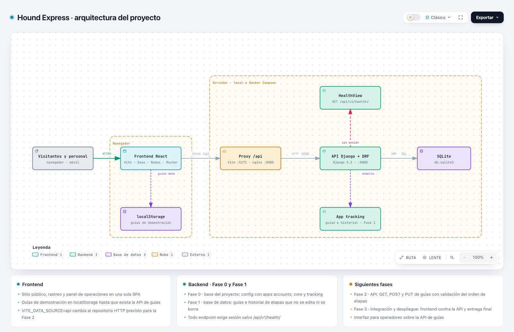
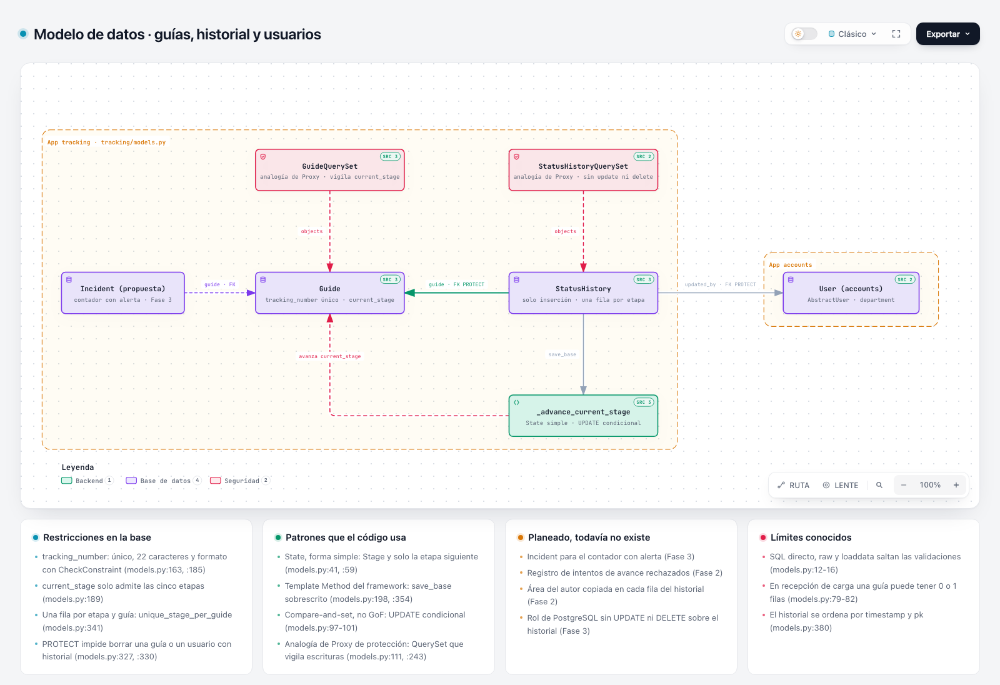
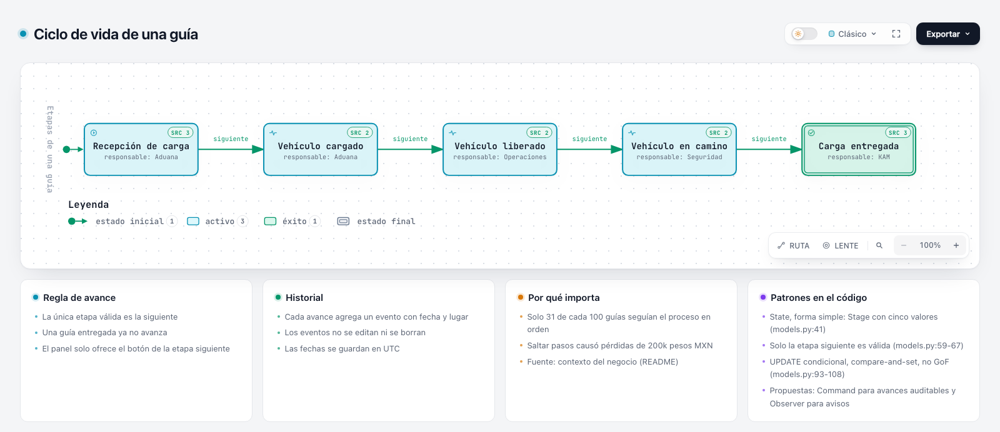
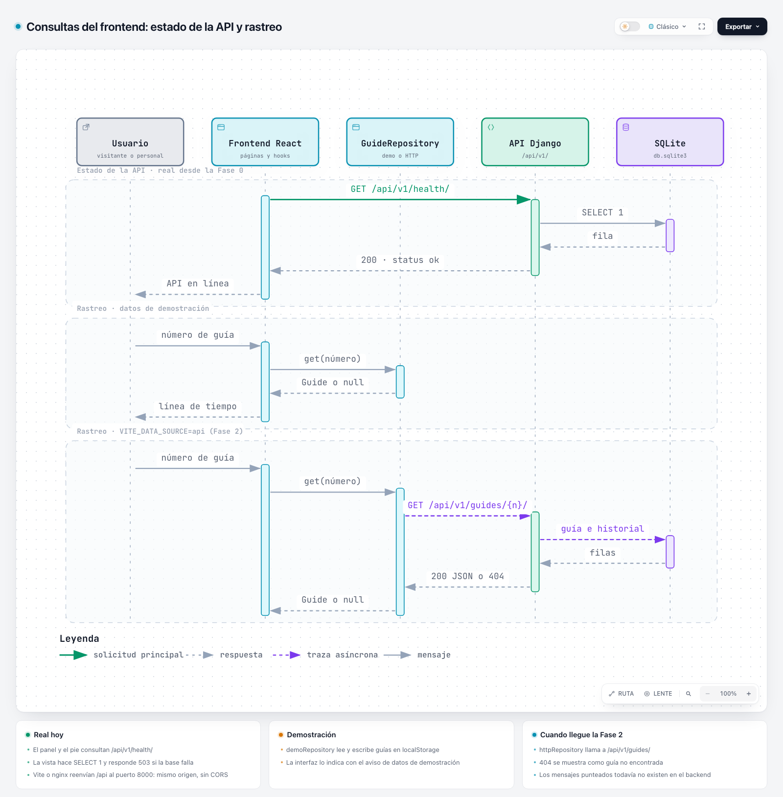

# Hound Express: seguimiento de guías

Plataforma para registrar las guías de carga de Hound Express y asegurar que cada una avance por las cinco etapas del proceso, en el orden establecido. El backend es una API en Django y el frontend, una aplicación en React; esta rama contiene las dos partes y el entorno de Docker.

**Estado actual:**

- **Frontend: rediseño del sitio de Hound Express** con rastreo y panel de operaciones. Funciona con **datos de demostración** guardados en el navegador hasta que existan los endpoints de guías; lo único que consulta del backend hoy es su estado (`/api/v1/health/`). Ver [Frontend](#frontend).
- **Backend en esta rama: Fase 0**, la base del proyecto. Las tablas de guías (Fase 1) están hechas en la rama `backend` y llegan a esta por `pruebas` (ver [Ramas](#ramas)).
- **Docker:** todo el proyecto se levanta con `docker compose up --build` (ver [Con Docker](#con-docker)).

## Estado por fase

| Fase | Alcance | Estado |
|---|---|---|
| 0 · base del proyecto | Proyecto Django con las apps `accounts`, `core` y `tracking`, modelo de usuario propio, punto de salud y CI | Hecha |
| 1 · base de datos | Guías y historial de etapas de solo inserción con restricciones en la base, departamento de cada usuario, panel de administración | Hecha en la rama `backend` |
| 2 · API | Endpoints GET (estado actual de una guía), POST (registrar una guía) y PUT (actualizar el estatus) con validación del orden de etapas | Planeada |
| 3 · integración y despliegue | Frontend conectado a la API, documentación para ejecutar el proyecto y despliegue | Planeada |

**Interfaz para operadores:** el panel de `/panel` ya aplica la regla de avance con datos de demostración; en la Fase 2 se conecta a los endpoints reales cambiando `VITE_DATA_SOURCE` a `api`.

## Qué contiene esta rama

Cada fila existe en el repositorio y se verifica en cada push con GitHub Actions.

| Capacidad | Evidencia |
|---|---|
| Proyecto Django con `manage.py` y las apps `accounts`, `core` y `tracking` | `INSTALLED_APPS` en [`backend/config/settings.py`](backend/config/settings.py) |
| Modelo de usuario propio, creado antes de la primera migración | [`backend/accounts/models.py`](backend/accounts/models.py), [`backend/accounts/migrations/0001_initial.py`](backend/accounts/migrations/0001_initial.py) |
| API con Django REST Framework: punto de salud que consulta la base de datos | [`backend/core/views.py`](backend/core/views.py), [`backend/core/tests/test_health.py`](backend/core/tests/test_health.py) |
| Configuración por variables de entorno, sin secretos en el repositorio | [`backend/config/settings.py`](backend/config/settings.py), [`backend/core/tests/test_settings.py`](backend/core/tests/test_settings.py) |
| Dependencias del backend con versiones fijas | [`backend/requirements.txt`](backend/requirements.txt), [`backend/uv.lock`](backend/uv.lock) |
| Frontend en React 19, TypeScript y Vite, con estilos en Sass (BEM), estado en Redux Toolkit y 278 pruebas con Jest | [`frontend/`](frontend/), [`frontend/README.md`](frontend/README.md) |
| Backend y frontend en contenedores, con nginx como proxy | [`docker-compose.yml`](docker-compose.yml), [`frontend/nginx.conf`](frontend/nginx.conf) |
| Lint y 13 pruebas del backend en Linux (Python 3.10 y 3.12) y Windows; lint, tipos, pruebas y compilación del frontend; y el arranque con Docker | [`.github/workflows/ci.yml`](.github/workflows/ci.yml) |

## Inicio rápido

Necesitas Git y Python 3.10 o superior (recomendado: 3.12). No hace falta crear un archivo `.env`.

**Antes de empezar:** la primera línea de cada bloque falla con `Necesitas Python 3.10 o superior` si tu Python es anterior (en macOS, el `python3` del sistema suele ser 3.9). En ese caso instala Python 3.12 desde [python.org](https://www.python.org/downloads/) (en macOS también con `brew install python@3.12`) y usa `python3.12` en lugar de `python3` en el bloque (en Windows, `py -3.12` en lugar de `py`). Para crear el entorno escribe `python3.12 -m venv --clear .venv` (Windows: `py -3.12 -m venv --clear .venv`): `--clear` reemplaza un `.venv` que ya exista, y sin él el entorno conserva Python 3.9.

### macOS y Linux

```bash
python3 -c "import sys; assert sys.version_info >= (3, 10), 'Necesitas Python 3.10 o superior'"
git clone https://github.com/pipeTawns-x/Houndxpress.git
cd Houndxpress/backend
python3 -m venv .venv
source .venv/bin/activate
python -m pip install -r requirements.txt
python manage.py migrate
python manage.py runserver
```

### Windows (PowerShell o cmd)

```powershell
py -c "import sys; assert sys.version_info >= (3, 10), 'Necesitas Python 3.10 o superior'"
git clone https://github.com/pipeTawns-x/Houndxpress.git
cd Houndxpress\backend
py -m venv .venv
.venv\Scripts\python -m pip install -r requirements.txt
.venv\Scripts\python manage.py migrate
.venv\Scripts\python manage.py runserver
```

No hace falta activar el entorno virtual: cada comando usa directamente el Python de `.venv`. Si `py` no existe, usa `python` en su lugar (en la primera línea y en `python -m venv .venv`).

Resultado esperado en cualquier sistema: la consola muestra `Starting development server at http://127.0.0.1:8000/`. La advertencia `WARNING: This is a development server` es normal en local. Abre <http://127.0.0.1:8000/> en el navegador: redirige a `/api/v1/health/`, donde la página de la API navegable de Django REST Framework muestra `"status": "ok"` y `"database": "ok"`. Detén el servidor con `Ctrl+C`.

## Verificar la instalación

Con el servidor encendido, abre otra terminal y ejecuta (en Windows, `curl.exe`):

```bash
curl http://127.0.0.1:8000/api/v1/health/
```

La respuesta esperada es `{"status":"ok","database":"ok"}`.

Pruebas y lint, desde `backend/` en cualquier terminal (usan el Python de `.venv`, sin activarlo):

```bash
.venv/bin/python -m pip install -r requirements-dev.txt
.venv/bin/python manage.py test
.venv/bin/python -m ruff check .
```

En Windows, escribe `.venv\Scripts\python` en lugar de `.venv/bin/python`. Resultado esperado: `Ran 13 tests` seguido de `OK`, y luego `All checks passed!`. Para el panel de administración, crea un usuario con `.venv/bin/python manage.py createsuperuser` y abre <http://127.0.0.1:8000/admin/>.

## Configuración

Todas las variables son opcionales en desarrollo: `DJANGO_DEBUG`, `DJANGO_SECRET_KEY`, `DJANGO_ALLOWED_HOSTS` y `DJANGO_ENV_FILE`. Para cambiar alguna, defínela en el entorno o en el archivo privado `backend/.env`, que git ignora. Las notas sobre cada variable van como comentarios dentro de ese mismo archivo.

| Variable | Valor por defecto | Obligatoria cuando |
|---|---|---|
| `DJANGO_DEBUG` | `true` | nunca |
| `DJANGO_SECRET_KEY` | clave de desarrollo marcada como insegura | `DJANGO_DEBUG=false` |
| `DJANGO_ALLOWED_HOSTS` | `localhost,127.0.0.1,[::1]` | `DJANGO_DEBUG=false` |
| `DJANGO_ENV_FILE` | `backend/.env` | nunca |

Con `DJANGO_DEBUG=false` el proyecto no arranca si falta alguna de las dos últimas, y rechaza claves que empiecen con `django-insecure`. `DJANGO_ENV_FILE` cambia la ruta del archivo de variables; apuntarla a un archivo que no existe hace que las pruebas ignoren el `.env` local. La base de datos es SQLite (`backend/db.sqlite3`, creada por `migrate`).

## Frontend

Rediseño no oficial del sitio de Hound Express en una sola aplicación: sitio público, rastreo de guías y panel de operaciones para el personal. El proceso de diseño (investigación del sitio actual, propuesta, abogado del diablo, arquitecto y revisión) está en [`docs/diseno/`](docs/diseno/).

| Ruta | Pantalla |
|---|---|
| `/` | Inicio con buscador de guía, cifras, servicios, las cinco etapas y cobertura |
| `/rastreo` | Rastreo simple o múltiple con línea de tiempo de etapas; acepta `?guia=NUMERO` |
| `/servicios`, `/cobertura`, `/nosotros`, `/preguntas`, `/contacto` | Sitio institucional |
| `/panel` | Panel de operaciones: resumen por etapa, registro de guías, lista con filtro, avance a la etapa siguiente e historial |
| `/disenos` | Índice de diseños: todas las pantallas y la guía de estilo en vivo |

Necesitas Node 20.19 o superior (recomendado: 22). Con el backend encendido en otra terminal (ver [Inicio rápido](#inicio-rápido)):

```bash
cd frontend
npm ci
npm run dev
```

Abre <http://localhost:5173/>. Vite reenvía `/api` y `/admin` a Django en `127.0.0.1:8000`, así que el pie de página y el panel muestran "API en línea" cuando el backend responde. Sin backend, la aplicación funciona igual y muestra "API sin conexión".

**Datos de demostración.** Las guías del rastreo y del panel se guardan solo en tu navegador (`localStorage`) y la interfaz lo indica. Guías de ejemplo para probar el rastreo: `2148 2139 0765 0312` (Recepción de carga), `2176 6402 1583 9927` (Vehículo liberado), `2119 8753 0246 7781` (Vehículo en camino) y `2154 3029 6817 0435` (Carga entregada); la lista completa está en [`frontend/README.md`](frontend/README.md#guías-de-ejemplo). El panel tiene un botón para restablecerlas. Cuando existan los endpoints de la Fase 2, `VITE_DATA_SOURCE=api` cambia al repositorio HTTP sin tocar las pantallas.

Pruebas y calidad, desde `frontend/`: `npm run lint`, `npm run typecheck`, `npm test` y `npm run build`. Resultado esperado: lint y tipos sin errores, `Tests:       278 passed, 278 total` y la compilación en `frontend/dist/`. Detalle en [`frontend/README.md`](frontend/README.md).

## Con Docker

Si prefieres no instalar Python ni Node, con Docker Desktop abierto:

```bash
git clone https://github.com/pipeTawns-x/Houndxpress.git
cd Houndxpress
docker compose up --build
```

Abre <http://localhost:8080/> para el frontend; nginx reenvía `/api`, `/admin` y `/static` a Django, que también responde directo en <http://localhost:8000/>. Comprueba la API a través de nginx con `curl http://localhost:8080/api/v1/health/` (en Windows, `curl.exe`): la respuesta esperada es `{"status":"ok","database":"ok"}`. Para el panel de administración: `docker compose exec backend python manage.py createsuperuser`. Detén todo con `Ctrl+C` y borra los contenedores con `docker compose down`.

Es un entorno de desarrollo: Django corre con `runserver` y `DJANGO_DEBUG=true`, y la base SQLite vive dentro del contenedor, así que `docker compose down` la borra. El job `docker compose` de [`ci.yml`](.github/workflows/ci.yml) reproduce este bloque en cada push.

## Seguridad

- **Sesión por defecto:** todo endpoint de la API exige sesión (`IsAuthenticated`), salvo `GET /api/v1/health/`. Una vista nueva hereda esa regla.
- **Producción:** con `DJANGO_DEBUG=false` se exigen clave secreta y hosts permitidos, y se activan la redirección a HTTPS y las cookies seguras.
- **Frontend:** no guarda secretos ni llama a servicios de terceros; el formulario de contacto no envía nada, arma un correo (`mailto:`) en el cliente de la persona. Las tipografías son autoalojadas.
- **Datos de demostración:** el panel guarda las guías solo en el navegador de quien lo usa y lo declara en pantalla.

## Diagramas

Los cuatro diagramas son interactivos (archivos HTML autónomos) y se generan con [Archify](https://github.com/tt-a1i/archify), instalado como skill del proyecto en [`.claude/skills/archify/`](.claude/skills/archify/). Aquí se muestran sus vistas previas; el detalle, los patrones con `archivo:línea` y cómo regenerarlos están en [`docs/diagramas/`](docs/diagramas/README.md).

**Arquitectura** ([`arquitectura.html`](docs/diagramas/arquitectura.html))



**Modelo de datos** ([`modelo-de-datos.html`](docs/diagramas/modelo-de-datos.html))



**Ciclo de vida de una guía** ([`ciclo-de-vida-guia.html`](docs/diagramas/ciclo-de-vida-guia.html))



**Secuencia de consultas** ([`secuencia-consultas.html`](docs/diagramas/secuencia-consultas.html))



## Estructura del repositorio

```text
Houndxpress/
├── .github/workflows/ci.yml   # Lint, pruebas, frontend, Docker y los comandos de este README en cada push
├── .claude/skills/archify/    # Skill Archify para generar diagramas (MIT)
├── AGENTS.md, CLAUDE.md       # Contexto del proyecto para agentes de IA
├── docker-compose.yml         # backend + frontend (nginx) para desarrollo
├── docs/
│   ├── STACK_HOUND_EXPRESS.md # Decisiones técnicas y licencias de las dependencias
│   ├── diseno/                # Investigación, propuesta, abogado del diablo, arquitecto y sistema de diseño
│   ├── herramientas/          # Evaluación de herramientas para el flujo de diseño y de código
│   └── diagramas/             # Diagramas interactivos (HTML), sus fuentes y vistas previas
├── frontend/                  # React + TypeScript + Vite + Sass (BEM)
│   ├── src/domain/            # Etapas, tipos y reglas de avance (sin React)
│   ├── src/services/          # Repositorio de guías (demostración y HTTP) y estado de la API
│   ├── src/pages/             # Una pantalla por ruta
│   ├── Dockerfile, nginx.conf # Imagen de producción del SPA y proxy a Django
│   └── package.json           # Scripts: dev, build, lint, typecheck, test
└── backend/                   # Proyecto Django: aquí vive manage.py
    ├── config/                # settings, urls, wsgi y asgi
    ├── accounts/              # Modelo de usuario del sistema
    ├── core/                  # Plataforma: punto de salud /api/v1/health/
    ├── tracking/              # Dominio de guías y etapas (las tablas están en la rama backend)
    ├── Dockerfile             # Imagen de desarrollo de la API
    ├── requirements.txt       # Dependencias de ejecución con versiones fijas
    ├── requirements-dev.txt   # Lo anterior más herramientas de desarrollo (ruff)
    └── pyproject.toml         # Declaración de dependencias; uv.lock fija el árbol completo
```

## Ramas

| Rama | Rol |
|---|---|
| `main` | Versión integrada y más completa del producto. Solo recibe cambios por PR desde `pruebas`. |
| `pruebas` | Integración: la suite completa y el CI en verde antes de pasar a `main`. |
| `backend` | La API en Django: modelos, reglas de etapas y, después, los endpoints. |
| `frontend` | Esta rama: la aplicación en React (sitio público, rastreo y panel de operaciones) con el entorno de Docker. |

El flujo es `backend` y `frontend` → PR a `pruebas` → PR de `pruebas` a `main`.

## Contexto del negocio

Hound Express es una empresa de mensajería dedicada a la importación en comercio electrónico, con entregas a nivel local e internacional. Cada guía debe registrar su estatus en este orden, y cada etapa tiene un departamento responsable:

| Orden | Etapa | Responsable |
|---|---|---|
| 1 | Recepción de carga | Aduana |
| 2 | Vehículo cargado | Aduana |
| 3 | Vehículo liberado | Operaciones |
| 4 | Vehículo en camino | Seguridad |
| 5 | Carga entregada | KAM |

Problemas que reporta la empresa:

- "Las guías de carga no siguen el proceso en el orden adecuado, saltando pasos para luego ponerlos con fechas posteriores."
- "El porcentaje de error es que de 100 guías solo el 31% siguen el proceso como debe ser y el otro 69% no lo sigue."
- "Pérdidas de 200k pesos MXN por sobrecostos y errores."
- "Se presentan errores humanos por sobrecarga."
- "No tienen datos para analizar y realizar históricos."

## Decisiones técnicas

El detalle está en [`docs/STACK_HOUND_EXPRESS.md`](docs/STACK_HOUND_EXPRESS.md). En resumen: Django 5.2 LTS con Django REST Framework; proyecto local con `manage.py` en lugar de una plantilla Docker de terceros, más un `docker-compose.yml` propio de dos servicios; frontend en React 19 con TypeScript, Vite, Sass con BEM (sin Tailwind), Redux Toolkit y Jest; SQLite por ahora; modelo de usuario propio desde el inicio; ninguna dependencia con licencia copyleft. Los archivos `requirements*.txt` se generan desde `backend/uv.lock` y no se editan a mano; los comandos están en ese documento.

## Derechos de uso

Este repositorio no incluye una licencia de código abierto. El código se cederá a Hound Express y el aviso de licencia se agregará cuando se formalice esa cesión. Las licencias de las dependencias están en [`docs/STACK_HOUND_EXPRESS.md`](docs/STACK_HOUND_EXPRESS.md).

El logotipo de `frontend/public/brand/` y los datos públicos del sitio (cifras, teléfonos, preguntas frecuentes) son de Hound Express y se usan porque el proyecto se desarrolla para la empresa; el frontend es un rediseño no oficial, no el sitio oficial. La skill de `.claude/skills/archify/` conserva su licencia MIT original.

## Autor

Felipe ([@pipeTawns-x](https://github.com/pipeTawns-x)).
