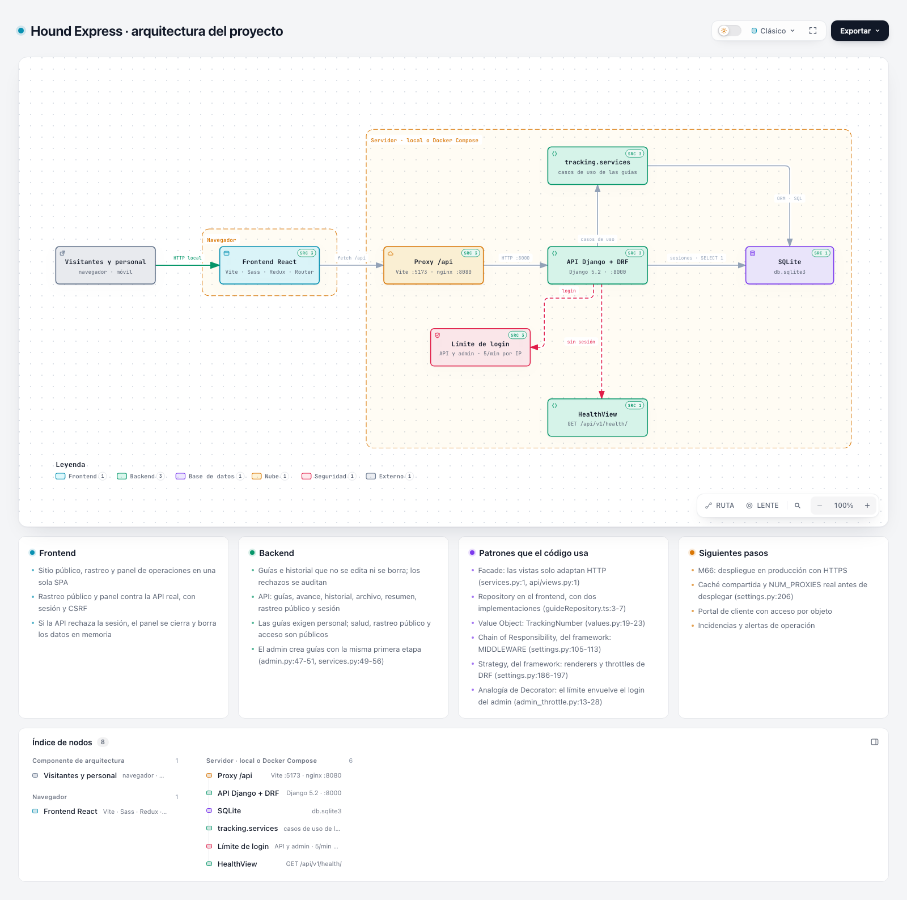
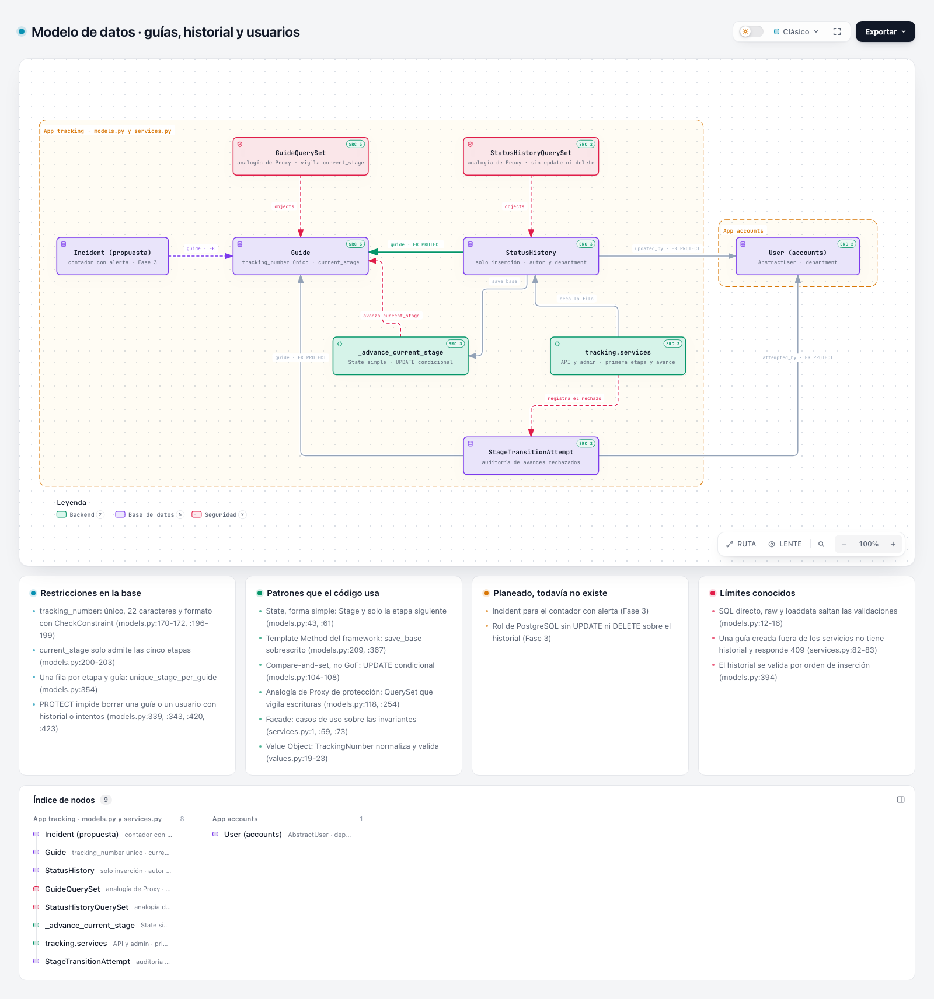
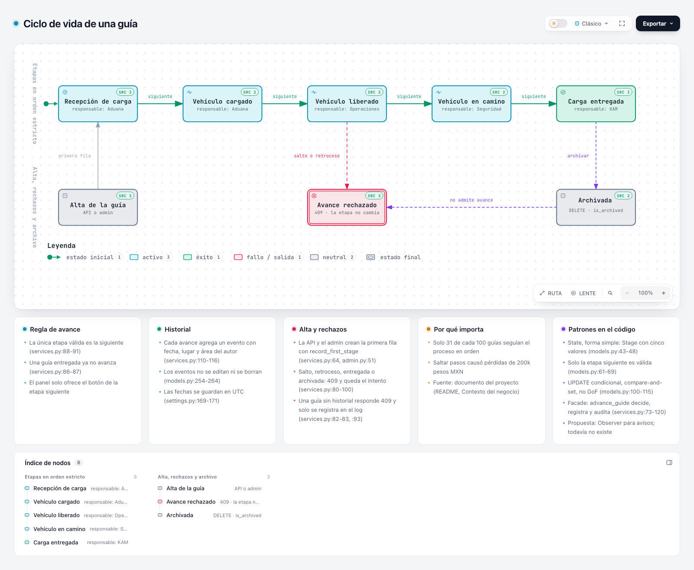
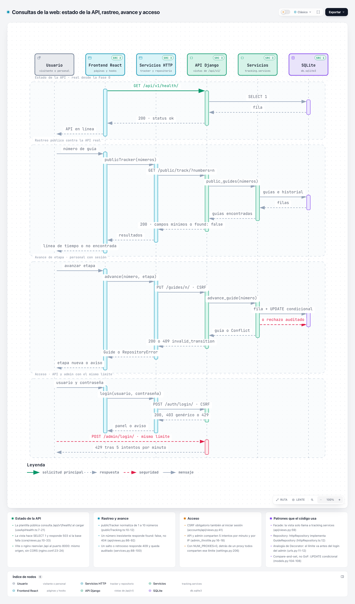

# Diagramas de Hound Express

Cuatro diagramas interactivos de la plataforma, generados con [Archify](https://github.com/tt-a1i/archify) 3.0.1 (licencia MIT). Cada archivo `.html` es autónomo: se abre en cualquier navegador sin instalar nada, permite acercar, seguir rutas, cambiar a tema oscuro y exportar a PNG, SVG o WebP desde el botón **Exportar**.

> GitHub muestra los `.html` como código. Para explorarlos, descarga el archivo (botón **Raw** o **Download raw file**) y ábrelo en el navegador. Las imágenes de esta página son vistas previas del tema claro.

| Diagrama | Qué muestra | Interactivo |
|---|---|---|
| Arquitectura | Navegador, frontend React, proxy `/api`, API Django, servicios de `tracking`, límite de login y SQLite | [`arquitectura.html`](arquitectura.html) |
| Modelo de datos | `Guide`, `StatusHistory`, `StageTransitionAttempt` y `User` con sus restricciones, los QuerySet que vigilan las escrituras, el UPDATE condicional y los servicios | [`modelo-de-datos.html`](modelo-de-datos.html) |
| Ciclo de vida de una guía | Las cinco etapas en orden estricto, su responsable y la regla de avance, más el alta, los rechazos y el archivo | [`ciclo-de-vida-guia.html`](ciclo-de-vida-guia.html) |
| Secuencia de consultas | Estado de la API, rastreo público, avance de etapa y acceso con límite compartido | [`secuencia-consultas.html`](secuencia-consultas.html) |

## Arquitectura



El frontend y la API se comunican por un proxy `/api` (Vite en desarrollo, nginx en Docker Compose), de modo que el navegador usa un solo origen y no necesita CORS. Las rutas de guías exigen personal con sesión; salud, rastreo público, CSRF e inicio de sesión son públicos. El inicio de sesión de la API y el del admin comparten un límite de 5 intentos por minuto y por IP.

## Modelo de datos



La regla de negocio vive en la base y en el modelo: una guía solo avanza registrando la etapa siguiente en `StatusHistory`, que es de solo inserción. Los avances rechazados quedan en `StageTransitionAttempt`, y tanto la API como el admin crean la primera fila con `record_first_stage`. Cada nodo del diagrama enlaza con su código.

## Ciclo de vida de una guía



## Secuencia de consultas



Todos los mensajes describen código que ya existe. Las respuestas van punteadas.

## Patrones y evidencia

Los cuatro diagramas anotan los patrones que el código usa. Cada patrón lleva una etiqueta honesta: **existe** (está en el código), **framework** (lo da Django o DRF), **analogía** (se parece, pero no es el patrón) o **propuesta** (todavía no existe). Los enlaces apuntan a una versión fija de esta edición, así que no cambian cuando el código evoluciona. Archify verifica las 70 referencias contra esa revisión: 17 en `arquitectura`, 21 en `modelo-de-datos`, 20 en `ciclo-de-vida-guia` y 12 en `secuencia-consultas`.

| Patrón | Etiqueta | Evidencia |
|---|---|---|
| State, forma simple: `Stage` y solo la etapa siguiente | existe | [`models.py:43-48`](https://github.com/pipeTawns-x/Houndxpress/blob/7b4141f9f711fc5853be1013ac028f7dff797eb4/backend/tracking/models.py#L43-L48), [`models.py:61-69`](https://github.com/pipeTawns-x/Houndxpress/blob/7b4141f9f711fc5853be1013ac028f7dff797eb4/backend/tracking/models.py#L61-L69) |
| Compare-and-set (no es GoF): UPDATE condicional de la etapa | existe | [`models.py:104-108`](https://github.com/pipeTawns-x/Houndxpress/blob/7b4141f9f711fc5853be1013ac028f7dff797eb4/backend/tracking/models.py#L104-L108) |
| Facade: casos de uso sobre las invariantes del modelo | existe | [`services.py:1`](https://github.com/pipeTawns-x/Houndxpress/blob/7b4141f9f711fc5853be1013ac028f7dff797eb4/backend/tracking/services.py#L1), [`services.py:73-120`](https://github.com/pipeTawns-x/Houndxpress/blob/7b4141f9f711fc5853be1013ac028f7dff797eb4/backend/tracking/services.py#L73-L120) |
| Value Object: `TrackingNumber` | existe | [`values.py:19-23`](https://github.com/pipeTawns-x/Houndxpress/blob/7b4141f9f711fc5853be1013ac028f7dff797eb4/backend/tracking/values.py#L19-L23) |
| Template Method del framework: `save_base` sobrescrito | framework | [`models.py:209`](https://github.com/pipeTawns-x/Houndxpress/blob/7b4141f9f711fc5853be1013ac028f7dff797eb4/backend/tracking/models.py#L209), [`models.py:367`](https://github.com/pipeTawns-x/Houndxpress/blob/7b4141f9f711fc5853be1013ac028f7dff797eb4/backend/tracking/models.py#L367) |
| Chain of Responsibility: `MIDDLEWARE` | framework | [`settings.py:105-113`](https://github.com/pipeTawns-x/Houndxpress/blob/7b4141f9f711fc5853be1013ac028f7dff797eb4/backend/config/settings.py#L105-L113) |
| Strategy: renderers y throttles de DRF | framework | [`settings.py:186-197`](https://github.com/pipeTawns-x/Houndxpress/blob/7b4141f9f711fc5853be1013ac028f7dff797eb4/backend/config/settings.py#L186-L197) |
| Proxy de protección: QuerySet que vigila las escrituras | analogía | [`models.py:118`](https://github.com/pipeTawns-x/Houndxpress/blob/7b4141f9f711fc5853be1013ac028f7dff797eb4/backend/tracking/models.py#L118), [`models.py:254`](https://github.com/pipeTawns-x/Houndxpress/blob/7b4141f9f711fc5853be1013ac028f7dff797eb4/backend/tracking/models.py#L254) |
| Decorator: el límite envuelve el login del admin | analogía | [`admin_throttle.py:13-28`](https://github.com/pipeTawns-x/Houndxpress/blob/7b4141f9f711fc5853be1013ac028f7dff797eb4/backend/config/admin_throttle.py#L13-L28), [`urls.py:11-12`](https://github.com/pipeTawns-x/Houndxpress/blob/7b4141f9f711fc5853be1013ac028f7dff797eb4/backend/config/urls.py#L11-L12) |
| Observer para avisos | propuesta | todavía no existe |

El catálogo de referencia es [refactoring.guru](https://refactoring.guru/es/design-patterns/catalog); se cita, nunca se copia.

## Cómo regenerarlos

Las fuentes son JSON y las produce un script, así que un cambio de arquitectura es un cambio de código revisable.

1. Instala Archify (Node 18 o superior) y un navegador Chromium para su revisión en navegador. Si no lo encuentra solo, indícalo con `ARCHIFY_CHROME=/ruta/al/navegador`. Con `ARCHIFY_UPDATE_CHECK_DISABLED=1` no consulta en internet si hay versiones nuevas.
2. Genera los JSON. `ARCHIFY_HOME` es la carpeta de Archify (la que contiene `bin/` y `examples/`); si Archify está en `.claude/skills/archify`, se puede omitir.

   ```bash
   ARCHIFY_HOME=<carpeta-de-archify> python3 docs/diagramas/fuentes/generar.py
   ```

3. Entrega cada diagrama con las cuatro compuertas de `finalize` en modo `showcase`: validación del esquema, entrega, revisión estricta del HTML y revisión en un navegador real. Los cuatro citan código, así que necesitan `--repo-root` con una copia del repositorio en la revisión que fija `generar.py`. Si el código cambia, actualiza en `generar.py` la revisión y las líneas citadas.

   ```bash
   node <carpeta-de-archify>/bin/archify.mjs finalize architecture docs/diagramas/fuentes/arquitectura.json docs/diagramas/arquitectura.html --repo-root <copia-en-la-revisión> --quality showcase --json
   node <carpeta-de-archify>/bin/archify.mjs finalize architecture docs/diagramas/fuentes/modelo-de-datos.json docs/diagramas/modelo-de-datos.html --repo-root <copia-en-la-revisión> --quality showcase --json
   node <carpeta-de-archify>/bin/archify.mjs finalize lifecycle docs/diagramas/fuentes/ciclo-de-vida-guia.json docs/diagramas/ciclo-de-vida-guia.html --repo-root <copia-en-la-revisión> --quality showcase --json
   node <carpeta-de-archify>/bin/archify.mjs finalize sequence docs/diagramas/fuentes/secuencia-consultas.json docs/diagramas/secuencia-consultas.html --repo-root <copia-en-la-revisión> --quality showcase --json
   ```

4. Haz la revisión visual de cada uno: `node <carpeta-de-archify>/bin/archify.mjs visual-check docs/diagramas/<nombre>.html --summary --require-provenance --out-dir <carpeta-temporal>`.

Los archivos `*.delivery.json` son la procedencia que liga cada HTML con su fuente. Guardan rutas absolutas, por eso se generan desde una carpeta temporal neutra y no desde una carpeta personal. Si una carpeta de evidencia ya existe de una corrida anterior, usa una nueva con `--out-dir`.

Las vistas previas de `img/` se capturan con el navegador sin interfaz, a 1600 px de ancho, a página completa y con `?theme=light` en la dirección del HTML.
