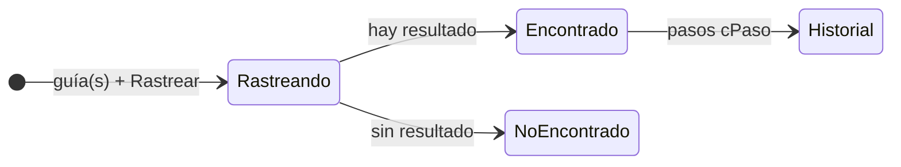

# REA · Sitio actual de Hound Express (resumen público)

**Fecha de captura:** 2026-10-27. **Herramienta:** REA (Reverse Engineer Anything) 6.7.0, observación pasiva por Chrome DevTools Protocol sobre Brave con perfil dedicado.
**Alcance:** feature `odd/tasks/contexto-rea-hound.md`, specs S1 y S2. Solo se observaron páginas públicas que ya estaban abiertas. No se consultó ninguna guía, no se recargó ninguna página y no se llamó a ninguna API de Hound.
**Versión pública y saneada.** La evidencia cruda y el informe completo se conservan en privado. Este resumen deja fuera los hallazgos de seguridad, las claves y los detalles de endpoints.

---

## 0. Cómo leer este resumen

Cada dato indica de qué comando de REA salió y su estado frente a [`01-sitio-y-comparativa.md`](01-sitio-y-comparativa.md) (01) y el documento interno de síntesis (04):

- **nuevo**: no figuraba antes.
- **confirmado**: REA observa lo mismo.
- **contradicho**: REA observa algo distinto.
- *sin contraste*: la afirmación previa no se puede revisar con esta captura.

Comandos usados: `rea list-browser-targets` (lista de pestañas), `rea inspect-web-page … --include-json-body-shapes --include-storage-keys --include-console-text` (DOM, scripts, recursos y consola) y `rea analyze-web-bundle` (análisis estático de los scripts). En adelante, `[I:<página>]` es `inspect-web-page` y `[B:<página>]` es `analyze-web-bundle`, con la clave JSON entre comillas.

**Límites de la captura.** REA se conecta después de que la página carga, así que no registró tráfico de red ni formas de datos de respuesta. Tampoco guarda el texto visible, el código fuente de los scripts ni valores de ningún tipo: solo la estructura (etiquetas y nombres de atributo). Lo que dependía de leer el JavaScript del rastreo queda *sin contraste*.

---

## 1. Mapa de páginas y flujos

### 1.1 Páginas capturadas

Inicio (`/hx/`), inicio en inglés (`/hx/en/`), Tracking (`/hx/tracking/`), rastreo heredado (`/tracking.html`), Servicio Cargo, Servicio Ecommerce, Cross Border México, Preguntas frecuentes, Contáctanos y Términos y condiciones. Son 10 páginas, todas observadas entre las 11:33:17Z y las 11:33:57Z. `[I:*] "normalized_result.target"`.

### 1.2 Dos sitios en el mismo dominio (nuevo)

- **`/hx/`** es un sitio WordPress construido con Elementor, con traducción automática Weglot y formularios Forminator. `[I:*] "normalized_result.scripts.items[].url"`.
- **`/tracking.html`** pertenece a un **sitio estático anterior**, con su propia pila (Bootstrap y jQuery) y su propia navegación hacia páginas `.html` antiguas (`index.html`, `nosotros.html`, `serviciocargo.html`, `terminos.html`, etc.). `[I:tracking-html] "normalized_result.metadata.dom_urls"`.

### 1.3 Flujo de rastreo

1. Todas las páginas WordPress en español enlazan a `/tracking.html` desde el botón "Rastrea paquete". **confirmado** (04: acción pública de rastreo).
2. **`/hx/tracking/` no contiene el formulario de rastreo.** Es una portada que enlaza a `/tracking.html`; su único campo es el selector de idioma. `[I:hx-tracking] "normalized_result.dom.nodes"`. **nuevo**.
3. En `/tracking.html` la entrada es un **campo de texto de una línea** marcado como obligatorio, con texto de ayuda asociado (`aria-describedby`) y sin restricción de longitud o patrón en el HTML. Hay un segundo control, probablemente el interruptor de rastreo múltiple. `[I:tracking-html] "normalized_result.dom.nodes[INPUT]"`. **contradicho** frente a 04, que describía un `textarea`: en el DOM observado no hay ninguno. El modo múltiple podría crearlo al activarse, y eso no se observó.
4. **Tres estados ilustrados con la mascota**: rastreando, encontrado y no encontrado. `[I:tracking-html] "normalized_result.metadata.dom_urls"` (imágenes `perro-hound-express-rastreando`, `-encontrando` y `-no-encontrado`). **nuevo**: 01 proponía estos estados sin haberlos observado.
5. La consulta la hace el JavaScript de la página en el navegador. El detalle se conserva en privado.

### 1.4 Audiencias, idiomas y contenido

- **Portal de clientes** en el mismo dominio, enlazado desde todas las páginas en español. **confirmado** (04).
- **Espejo en inglés**: la traducción automática reescribe los enlaces de rastreo y del portal bajo `/hx/en/`. Por lo que 01 registró sobre un alias parecido (404), **probablemente quedan rotos**. No se verificó. `[I:en] "normalized_result.metadata.dom_urls"`. **nuevo**.
- **Página histórica todavía enlazada**: Servicio Cargo enlaza a `/hx/servicio-ecommerce-anterior/`, que 01 marcó como exclusión histórica. `[I:cargo]`. **nuevo**.
- **Ecommerce con anclas internas**: cross-border, transporte, logística inversa, última milla y almacén. `[I:ecommerce]`. **confirmado** (01 §3).
- **Ventanas emergentes** en Servicio Cargo y Servicio Ecommerce (popups de Elementor); su contenido no se observó. **nuevo**.
- **Formulario de contacto** en Inicio, Inicio en inglés, Preguntas y Contacto: correo, teléfono con selector de país, una lista desplegable con búsqueda, una casilla (probablemente la aceptación de privacidad) y campos ocultos del plugin. `[I:contacto] "normalized_result.dom.nodes"`. **confirmado en estructura** (01 §3 y 04); las etiquetas no son observables. Cross Border México añade una verificación antibots. **nuevo**.

---

## 2. Endpoints y formas de datos

REA no registró tráfico de red (0 peticiones en las 10 páginas), así que **no hay formas de datos observadas**. El análisis estático no encontró endpoints de la aplicación más allá de los propios de WordPress y de un formulario heredado. Los candidatos y la forma documentada de la respuesta de rastreo se conservan en el informe privado.

---

## 3. Máquina de estados del envío según Hound

| Capa | Qué se observa | Fuente | Estado |
|---|---|---|---|
| Estados de la interfaz | rastreando → encontrado o no encontrado | `[I:tracking-html]` (ilustraciones) | **nuevo** |
| Progreso del envío | historial escalonado `cPaso`; el catálogo de pasos no se conoce | 04 (lectura del JS, 2026-10-12) | *sin contraste* |
| Historial del contrato oficial | código, descripción y fecha por evento | 01 §4 (documentación de Sabueso) | *sin contraste* |
| Incidencias | detenido en aduana, importación prohibida, entregado sin recibir, extraviado, devuelto | 01 §4 (FAQ) | *sin contraste* |

Nuestro modelo, en cambio, tiene 5 etapas lineales y solo admite la siguiente (§5).

---

## 4. Seguridad

Los hallazgos de seguridad sobre el sitio vivo de Hound se conservan en privado hasta que Hound sea notificado.

---

## 5. Hound frente a nuestro modelo M54

Modelo: `houndxpress-backend/backend/tracking/models.py`.

| Aspecto | Hound | Nuestro M54 | Recomendación |
|---|---|---|---|
| Formato de guía | FAQ: 16 o 22 caracteres (01 §4, *sin contraste*). El campo no restringe longitud ni patrón en el HTML (**nuevo**). | `CharField(max_length=22, unique=True)` con regex `^(21[0-9]{14}\|[A-Z0-9]{22})$` y `CheckConstraint` igual. | Mantener. **M64**: normalizar la entrada (`strip`, `upper`) antes de validar. |
| Rastreo múltiple | Varias guías por consulta (04). | Una guía (no hay API todavía). | **M64/M66**: consulta múltiple con tope y limitación de tasa por guía. |
| Etapas | Historial `cPaso`, catálogo desconocido; incidencias aparte. | 5 etapas lineales: recepción de carga → vehículo cargado → vehículo liberado → vehículo en camino → carga entregada; una por guía (`UniqueConstraint`). | Mantener en M54. **M64/M66**: incidencias como eventos separados y una tabla de equivalencias `cPaso` → etapa si se integra Sabueso. |
| Estados de la interfaz | rastreando, encontrado y no encontrado. | No aplica (backend). | **M66**: añadir "servicio no disponible" y "sin eventos todavía". |
| Fecha por evento | Fecha por paso (contrato). | `timestamp` con fecha del servidor. | Mantener. |
| Quién recibió | La vista de resultado incluye el nombre de quien recibió (04). | `recipient` obligatorio. | **M64**: la vista pública nunca devuelve `recipient`; solo el vendedor dueño autenticado. |
| Ubicación | Coordenadas con enlace a mapa (04). | Sin coordenadas; `location` en texto, hasta 100 caracteres. | Mantener sin coordenadas. **M64**: la vista pública muestra solo ciudad o centro. |
| Referencia del cliente | Aparece en el resultado (04). | No existe. | No añadirla en M54; si llega, solo para el dueño autenticado. |
| Origen y destino | No observado. | `origin` y `destination`. | **M64**: público solo a nivel de ciudad. |
| Autor y nota del cambio | No observado. | `updated_by` y `note`. | **M64**: nunca públicos. |

**Minimización.** La vista pública de rastreo devuelve solo número de guía, etapa actual e historial (etapa, fecha y ubicación gruesa). Destinatario, notas, autor y datos de detalle quedan detrás de autenticación y de autorización por guía.

**Cambios al modelo M54:** ninguno ahora. El bloque M54.1 exige modelos intactos, y el modelo ya evita coordenadas y fija las etapas. Lo demás se aplica en serializadores y vistas (M64) o en la interfaz y el despliegue (M66).

---

## 6. Ideas y mejoras para nuestra versión

### Tomar

1. Dos accesos fijos en el encabezado: "Rastrea paquete" y "Portal cliente".
2. Estados del rastreo ilustrados con la mascota, completados con "error de servicio" y "sin eventos todavía".
3. Texto de ayuda asociado al campo de guía (`aria-describedby`).
4. Rastreo múltiple con un tope explícito.
5. Plantilla de servicio con anclas internas, como Ecommerce.
6. Sitio bilingüe ES/EN.

### Mejorar

1. **Una sola aplicación**: el rastreo integrado con el mismo encabezado y la misma navegación, no en un sitio aparte.
2. **Validación de la guía** en el cliente y en el servidor: longitud, normalización y formato, con mensajes claros.
3. **Rutas de idioma explícitas**, sin reescritura automática de enlaces de la aplicación.
4. **Sin páginas históricas enlazadas.**
5. **Datos mínimos** en la vista pública (§5).
6. **Pocos terceros, y con consentimiento.**
