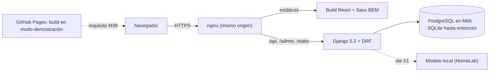
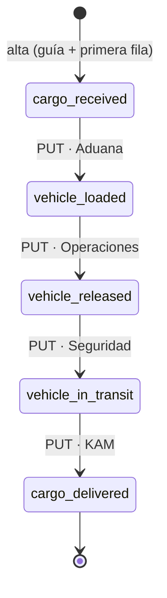

Reconstruida desde Engram #946 el 2026-10-27. El texto completo de la v1 se recuperó de la copia que el script del kit hizo el 2026-10-14 (`~/kit-claude-design/05-PROPUESTA-V3.md`, copiada por la línea 41 de `docs/loops/armar-kit-claude-design.sh` en su versión sin commit) y se contrastó con Engram #946 (propuesta maestra), #853 (propuesta v0), #933 y #939 (ciclos anteriores con el abogado del diablo). El original `docs/propuesta/README.md` nunca llegó a git (bitácora del feature, L8).

# Hound Express · Propuesta maestra del proyecto (v2)

> **Rediseño integral y plataforma de rastreo — "El viaje del paquete".**
> Qué se construye, por qué, cómo, con quién y cómo se verifica. Documento para personas; los agentes leen `AGENTS.md`, `.codex/agents/` y `docs/loops/`.

| Campo | Valor |
|---|---|
| Repositorio | [`pipeTawns-x/Houndxpress`](https://github.com/pipeTawns-x/Houndxpress), rama `practicas-ebac` |
| Versión | v2, 2026-10-27. Sustituye a la v1 del 2026-10-13 |
| Feature | `odd/tasks/contexto-rea-hound.md`, tarea T4, spec S3 |
| Estado | Propuesta para aprobación. Lo marcado como "propuesto" no está implementado |
| Decide | Eduardo Torres: lidera, aprueba compuertas y ejecuta git con red, npm y Homebrew |
| Documentos hermanos | [`abogado-del-diablo.md`](abogado-del-diablo.md) (las críticas) y [`blueprint.md`](blueprint.md) (el diseño técnico de M64 y M66) |

## Lectura rápida

- **5 minutos:** §0.2 (qué cambia), §1 (resumen) y §19 (decisiones).
- **Backend y API:** §8, §9 y el [blueprint](blueprint.md).
- **Seguridad:** §15 y el blueprint §14.
- **Diseño:** §4 a §7 y §11.

## Índice

0. [Qué cambia en la v2](#0-qué-cambia-en-la-v2)
1. [Resumen ejecutivo](#1-resumen-ejecutivo)
2. [Contexto](#2-contexto)
3. [Diagnóstico del sitio actual](#3-diagnóstico-del-sitio-actual)
4. [Visión y principios](#4-visión-y-principios)
5. [Alcance: inventario de vistas](#5-alcance-inventario-de-vistas)
6. [Sistema de diseño](#6-sistema-de-diseño)
7. [Referencias de diseño](#7-referencias-de-diseño)
8. [Arquitectura técnica](#8-arquitectura-técnica)
9. [Núcleo EBAC: M54, M64 y M66](#9-núcleo-ebac-m54-m64-y-m66)
10. [Mejoras por olas](#10-mejoras-por-olas)
11. [Flujo de diseño con Claude Design](#11-flujo-de-diseño-con-claude-design)
12. [Equipo agéntico](#12-equipo-agéntico)
13. [Metodología de trabajo](#13-metodología-de-trabajo)
14. [Calidad: estrategia de pruebas](#14-calidad-estrategia-de-pruebas)
15. [Seguridad y cumplimiento](#15-seguridad-y-cumplimiento)
16. [Rendimiento, SEO, privacidad, idiomas y contenido](#16-rendimiento-seo-privacidad-idiomas-y-contenido)
17. [Plan de entrega](#17-plan-de-entrega)
18. [Riesgos](#18-riesgos)
19. [Decisiones](#19-decisiones)
20. [Higiene del repositorio](#20-higiene-del-repositorio)
21. [Glosario](#21-glosario)
22. [Apéndices](#22-apéndices)

---

## 0. Qué cambia en la v2

### 0.1 Por qué hay una v2

1. La v1 nunca se versionó; esta versión la recupera y la deja en git.
2. Desde la v1 se entregó M54 (etiqueta `m54`, PR #4) y se preparó M54.1 en la rama `backend` (`0fc74ad..aed7967`): Django 5.2.18, DRF 3.18.3, controles de OWASP ASVS 5.0 nivel 1 y `Ran 108 tests` OK.
3. Se observó el sitio actual de Hound con REA ([`docs/investigacion/rea-sitio-actual.md`](../investigacion/rea-sitio-actual.md)).
4. El abogado del diablo atacó la v1 y M54.1 desde ocho ángulos, con tres pasadas de revisión de base de datos ([`abogado-del-diablo.md`](abogado-del-diablo.md)).

### 0.2 Cambios en una tabla

| Tema | v1 | v2 | Por qué |
|---|---|---|---|
| Metodología | SDD por cambio | ODD: feature con specs textuales y bitácora; las tareas pequeñas van en línea | Regla global §1 (C02) |
| Variables de entorno | `backend/.env.example` | Solo `backend/.env`, privado; las notas van como comentarios dentro | Regla global §4 (C03). Eliminado en `9b334c0` |
| Capas del backend | `domain.py` + `services.py` + `api/` | Invariantes en el modelo (como ya están) + `services.py` como fachada de casos de uso + `api/` | El modelo ya protege admin, shell y API (C05) |
| Alta de guía | "201 con historial inicial" | El servicio crea guía y primera fila en la misma transacción | El modelo admite 0 filas en recepción (C06) |
| PUT repetido | 409 | 200 con el estado actual si la etapa pedida ya es la actual; 409 solo ante salto o retroceso. Queda como decisión de Eduardo (E7) | Idempotencia (C13) |
| Intentos de salto | No se registraban | Se guardan (quién, guía, etapa pedida, etapa actual, hora) | Es la métrica del problema original (C09) |
| Área en el historial | Prometida | Se copia el área del autor en cada fila (M64) | `department` es mutable (C25) |
| Límite del rastreo público | Por petición | Por guía consultada, tope de 10 por petición | El rastreo múltiple multiplica el límite (C15) |
| Entorno de M66 | Decisión D6 abierta | Decidir host, base, roles y caché antes de escribir M64 | El defecto que mata la propuesta (§4 del abogado) |
| Ruta crítica | Diseño de 42 vistas → construcción | Se diseñan las 42 vistas, pero M64 y M66 no esperan a las 34 pendientes | C12 |
| Patrones | "Proxy de protección existe" | "Analogía de Proxy": control de acceso por herencia | C04 |
| Hallazgos del sitio vivo | Descritos en §3.3 y §15.4 | Solo en el informe privado hasta notificar a Hound | Divulgación responsable (§15.5) |

### 0.3 Críticas aceptadas y rechazadas

Detalle y evidencia de cada una en [`abogado-del-diablo.md`](abogado-del-diablo.md). `C` son críticas a la propuesta y a M54.1; `BD`, hallazgos de las pasadas de base de datos; `D1` a `D16`, decisiones de la v1; `E1` a `E12`, decisiones nuevas. Horizonte: "ahora" son documentos; M64 y M66 son prácticas; "ola" va después de M66; "Eduardo" es una decisión de §19.2.

| ID | Crítica | Severidad | Veredicto | Razón | Horizonte |
|---|---|---|---|---|---|
| C01 | La propuesta no estaba en git | Alta | Aceptada | Es el documento rector; se versiona esta v2 | Ahora |
| C02 | SDD como columna vertebral | Media | Aceptada | La regla global §1 lo retiró | Ahora |
| C03 | `.env.example` como documentación | Media | Aceptada | Regla global §4; ya eliminado | Ahora |
| C04 | "El Proxy existe" | Baja | Aceptada | Es control por herencia: se etiqueta como analogía | Ahora |
| C05 | Capas `domain.py` y `services.py` | Media | Aceptada en parte | Sin `domain.py`; `services.py` sí, como fachada | M64 |
| C06 | Alta sin historial inicial | Media | Aceptada | Sin la primera fila no hay fecha de recepción | M64 |
| C07 | Límite compartido detrás del proxy y por proceso | Media / Alta en M66 | Aceptada | `NUM_PROXIES` real y caché compartida | M66 |
| C08 | Datos de estado viejos | Baja | Aceptada | Corregidos en §2.3 | Ahora |
| C09 | Los intentos de salto no se registran | Media | Aceptada | Sin ese registro no hay indicador de cumplimiento | M64 |
| C10 | El orden no prueba el hecho físico | Media | Aceptada | Tiempo por etapa y alerta de ráfagas | Ola |
| C11 | Sin datos reales no compite como rastreador | Media | Aceptada | Se vende control del proceso y rastreo seguro (§1) | Ahora |
| C12 | 42 vistas con 8 diseñadas | Alta | Aceptada en parte | Se mantiene la decisión de Eduardo de diseñar las 42; cambia solo el orden | Ahora |
| C13 | PUT no idempotente en su respuesta | Media | Aceptada | Reintento seguro; Eduardo confirma (E7) | M64 |
| C14 | `__Host-csrftoken` y el SPA | Media | Aceptada | El SPA obtiene el token de `GET /api/v1/auth/csrf/` | M66 |
| C15 | El límite cuenta peticiones, no guías | Media | Aceptada | Costo por guía | M64 |
| C16 | Números de guía en la URL | Baja | Aceptada en parte | Se mantiene GET (D4); los registros no guardan la query del rastreo | M66 |
| C17 | Host gratuito que se pausa en la revisión | Alta | Aceptada | Pasa a decisión E2 | Eduardo |
| C18 | Créditos frente a la regla de datos | Media | Aceptada | Trabajo con datos de Hound en Claude; lo genérico en OpenCode | Ahora |
| C19 | Una persona para red, git y aprobaciones | Media | Aceptada | Un frente a la vez y un bloque de comandos por intervención | Ahora |
| C20 | Sin prueba de concurrencia real | Media | Aceptada | `TransactionTestCase` contra PostgreSQL en CI | M66 |
| C21 | Admin sin freno de fuerza bruta | Media / Alta en M66 | Aceptada | Bloquea M66; el mecanismo lo elige Eduardo (E1) | Eduardo |
| C22 | Exclusión privada solo en local | Alta | Aceptada | `.gitignore` versionado (E8) | Eduardo |
| C23 | Datos personales sin retención | Media | Aceptada | Pasa a decisión E5 | Eduardo |
| C24 | Sin vía de corrección operativa | Media | Aceptada | Pasa a decisión E4 | Eduardo |
| C25 | El historial no guarda el área | Media | Aceptada | Columna nueva, migración aditiva | M64 |
| C26 | El CI no corre los controles declarados | Media | Aceptada | Pasa a decisión E9 | Eduardo |
| C27 | Notificación a Hound y permiso de marca pendientes | Alta | Aceptada | Ya eran pendientes de la v1 (E10) | Eduardo |
| C28 | HSTS de un año con precarga | Info | Rechazada | Los hosts candidatos solo sirven HTTPS; se revisa si aparece un dominio propio | — |
| C29 | Se aceptan contraseñas solo numéricas | Info | Rechazada | ASVS 6.2.5 prohíbe reglas de composición | — |
| C30 | Usar librería de estados o State completo | Baja | Rechazada | Flujo lineal sin comportamiento por etapa; licencias (v1 §8.2) | — |
| C31 | UUID como identificador público | Baja | Rechazada | El cliente tiene el número de guía (D4) | — |
| C32 | Guardar coordenadas como Hound | Baja | Rechazada | Más datos personales sin beneficio (REA §5) | — |
| C33 | La vista navegable muestra el `charset` | Info | Rechazada | Aceptado por el verificador; no expone nada | — |
| BD01 | Mínimo privilegio en la base | Media | Aceptada | Rol de la app sin `UPDATE` ni `DELETE` sobre el historial | M66 |
| BD02 | Supabase expone `public` sin RLS | Alta, condicional | Aceptada | Si se elige Supabase: esquema no expuesto o RLS sin políticas | M66 |
| BD03 | Índice de clave foránea redundante | Info | Rechazada por ahora | Beneficio nulo a escala de demostración; quitarlo exige migración | — |
| BD04 | `service_level` admite `""` | Baja | Aceptada | Restricción en la base | M64 |
| BD05 | `note` sin límite | Baja | Aceptada | Tope en el serializador | M64 |
| BD07 | N+1 en la API | Media | Aceptada | `prefetch_related` y prueba de número de consultas | M64 |
| BD08 | Contadores sin índice | Baja | Aceptada como medición | Índice parcial solo si `EXPLAIN ANALYZE` lo pide | M66 |
| BD09 | Paginación | Baja | Aceptada | `CursorPagination` | M64 |
| BD11 | Lectura del historial por inserción | Info | Sin acción | Acotada a 5 filas | — |
| BD12 | Orden del historial por reloj de la aplicación | Media | Aceptada | Ordenar por `pk`, sin migración | M64 |
| BD13 | Sin RPO ni RTO | Media | Aceptada | Depende de E3 (datos reales o de demostración) | Eduardo |
| BD14 | Conexiones y pooler | Media | Aceptada | `CONN_MAX_AGE` y pooler del proveedor | M66 |
| BD15 | Presupuesto de bloqueo en migraciones | Baja | Aceptada en parte | `lock_timeout` en el procedimiento de M66 | M66 |

**Qué cambia en M54 ahora: nada en los modelos.** Ninguna crítica demostró un bloqueo para la entrega de M54: BD12 solo aparece con más de una instancia, C06 se resuelve en el servicio de M64 y BD04 es de severidad baja. Los cambios de modelo de M64 son aditivos y van con su propia migración.

---

## 1. Resumen ejecutivo

**Qué es.** Un rediseño integral de la presencia digital de Hound Express y una plataforma de rastreo propia, construidos como proyecto final del programa *Profesión: Desarrollador Full Stack Python* de EBAC, con Hound Express como empresa aliada.

**Para quién.**

- **Clientes de ecommerce** que rastrean envíos, cotizan y comparan servicios cross-border.
- **Operaciones de Hound Express** (áreas Aduana, Operaciones, Seguridad y KAM), que registran guías y avanzan sus etapas.
- **La empresa**, que gana marca, control del proceso y una base técnica que puede adoptar.

**Qué se demuestra (cambia en la v2, C11).** No se compite con Sabueso ni con agregadores como rastreador de datos reales. Se demuestran tres cosas que el sitio actual no tiene:

1. **Control del proceso:** las etapas solo avanzan en orden, con fecha del servidor, historial inmutable y registro de los intentos de salto. El problema original era que solo 31 de cada 100 guías seguían el orden (#851).
2. **Rastreo público seguro:** sin secretos en el navegador, con datos mínimos, límite de consultas y respuestas que no revelan si una guía existe.
3. **Diseño propio:** un sistema de diseño en Sass con BEM y 42 vistas coherentes.

**Qué se entrega.**

1. **Núcleo EBAC con evidencia:** M54 (hecho), M64 (endpoints con validación del orden) y M66 (integración, contadores y publicación).
2. **Rediseño:** 42 vistas en tres grupos (§5), diseñadas en Claude Design.
3. **Vitrinas "antes y después":** diseño, seguridad, rendimiento y privacidad (§4.3).
4. **Mejoras por olas** (§10).

**Cómo se mide.** Compuertas de aprobación (§13.3), casos críticos (§14.2), presupuestos de rendimiento (§16.1) y los requisitos de [`docs/REQUISITOS_EBAC.md`](../REQUISITOS_EBAC.md), que mandan sobre cualquier decisión técnica.

**Por qué importa.** El PDF oficial (p. 24) indica que los mejores trabajos pueden llegar a la bolsa de talento de Hound Express.

---

## 2. Contexto

### 2.1 La empresa

Logística cross-border para ecommerce, con presencia en México y Estados Unidos y operación hacia Latinoamérica. Servicios Cargo, Customs, Parcel y Ecommerce; cobertura en México, Argentina, Colombia, Chile y Brasil; alianzas con Amazon (SPN y Latam) y Walmart Marketplace; 56 entradas de blog y una sección de noticias.

### 2.2 Origen académico y reglas que mandan

- Requisitos del PDF oficial: [`docs/REQUISITOS_EBAC.md`](../REQUISITOS_EBAC.md). **Mandan sobre cualquier decisión técnica que los contradiga.**
- Módulos: M52 (100/100, etiqueta `m52`), M54 (entregada, etiqueta `m54`; M54.1 en preparación), M64 y M66 pendientes.
- El frontend usa Sass con BEM, React, TypeScript, Redux y Jest porque el documento oficial lo pide (regla 7 de `CLAUDE.md`).
- Términos (PDF pp. 29-30): el trabajo se cede a Hound Express; el repositorio no lleva licencia hasta la cesión.
- Reglas globales de Eduardo: ODD, prioridad seguridad → diseño → funcionalidad → escalabilidad, sin `.env.example`, ningún dato ni código de Hound a modelos gratuitos sin su aprobación.

### 2.3 Estado del repositorio (actualizado, C08)

| Capa | Estado verificado |
|---|---|
| Backend | Django 5.2.18 + DRF 3.18.3 en `aed7967` (rama `backend`, sin push). Apps `accounts` (usuario propio con `department`), `core` (`GET /api/v1/health/`, 503 si la base falla) y `tracking` (`Guide` y `StatusHistory`). SQLite con `transaction_mode: IMMEDIATE`. Sesión y `IsAuthenticated` por defecto, límites de DRF y configuración de producción con `check --deploy` en 0. `Ran 108 tests` OK |
| Frontend | React 19 + TypeScript + Vite + React Router 7 + Redux Toolkit + Sass BEM (7-1) + Jest. Sin Axios ni Tailwind |
| Rediseño | v1: 12 pantallas en 390 y 1440 px. v3 en Claude Design: lotes 0 a 5 (sistema y 8 de 42 vistas) |
| Infraestructura | `docker compose`: backend en `:8000` y nginx en `:8080`, que reenvía `/api`, `/admin` y `/static` |
| CI | Ruff, `check`, `makemigrations --check`, `migrate` y pruebas del backend (Linux y Windows), bloques del README, frontend y Docker |

---

## 3. Diagnóstico del sitio actual

### 3.1 Inventario

Fuente: sitemap del sitio vivo (`/hx/sitemap_index.xml`, 2026-10-13) y observación pasiva con REA (2026-10-27).

| Tipo | Cantidad | Detalle |
|---|---|---|
| Páginas | 26 | Inicio duplicada (`/hx/` y `/hx/inicio/`), servicios, países, alianzas, blog, noticias, preguntas, contacto, rastreo, legales y páginas obsoletas indexadas |
| Landings | 5 | Vende en USA, Vende en USA Walmart, Café Express, RBA y Cotiza |
| Entradas | 56 | Español e inglés como entradas separadas, con duplicados |
| Fuera de WordPress | 2 | `/tracking.html` (sitio estático anterior) y el portal de clientes |
| Espejo de idioma | 1 | `/hx/en/`, traducción automática |

### 3.2 Dos sitios en el mismo dominio (REA)

`/hx/` es WordPress con Elementor, Weglot y Forminator. `/tracking.html` pertenece a un sitio estático anterior, con su propia navegación hacia páginas `.html` antiguas. `/hx/tracking/` no tiene formulario: enlaza a `/tracking.html` (REA §1.2 y §1.3).

### 3.3 Seguridad

Los hallazgos de seguridad sobre el sitio vivo se conservan en el informe privado y no se describen en este repositorio hasta notificar a Hound (§15.5). La v1 los describía aquí; la v2 los retira.

### 3.4 Diseño y experiencia

- Plantilla con fotografía de stock y carrusel; Open Sans por defecto.
- Rastreo en un sitio aparte, con otra navegación; tres estados ilustrados con la mascota (rastreando, encontrado y no encontrado; REA §1.3).
- Colores del CSS vivo (`#17233D`, `#6EC1E4`) desviados del logotipo (`#18233E`, `#4CBED8`).
- Enlaces rotos o mal dirigidos y una página histórica todavía enlazada (REA §1.4).
- Horario de atención distinto entre preguntas frecuentes y contacto.

### 3.5 Rendimiento y privacidad

Varios servicios de terceros en cada página (analítica, publicidad, mapas de calor y antispam), que pesan en la carga y obligan a gestionar consentimiento.

### 3.6 SEO

Duplicados indexados y un espejo de idioma sin estrategia propia. En nuestro frontend faltan `robots.txt`, `sitemap.xml` y Open Graph (M38 "en parte").

---

## 4. Visión y principios

### 4.1 Idea rectora: "el viaje del paquete"

Toda la experiencia cuelga de las **cinco etapas de la regla de negocio**, en orden estricto:

| # | Etapa | Código | Área responsable |
|---|---|---|---|
| 1 | Recepción de carga | `cargo_received` | Aduana |
| 2 | Vehículo cargado | `vehicle_loaded` | Aduana |
| 3 | Vehículo liberado | `vehicle_released` | Operaciones |
| 4 | Vehículo en camino | `vehicle_in_transit` | Seguridad |
| 5 | Carga entregada | `cargo_delivered` | KAM |

El sitio público cuenta el viaje, el rastreo muestra el de un paquete, el portal reúne los de una cuenta y el panel opera todos. La tarjeta `ops-card` (etapa actual, última ubicación y progreso) aparece en el héroe del Inicio, en el resultado del rastreo y en cada fila del panel.

**Hound frente a las cinco etapas (REA §3).** El sitio actual separa la búsqueda (rastreando, encontrado o no encontrado) del progreso del envío, que muestra como pasos `cPaso` de catálogo desconocido. No hay equivalencia definida entre esos pasos y nuestras etapas, y no se inventa (regla de `hound-dominio`). Si algún día se integra Sabueso, la tabla de equivalencias vive en el adaptador (ola 3). Diagrama: [`docs/diagramas/ciclo-de-vida-guia.html`](../diagramas/ciclo-de-vida-guia.html).

### 4.2 Principios

| Principio | Qué significa en la práctica |
|---|---|
| Requisitos EBAC primero | Ninguna decisión contradice `REQUISITOS_EBAC.md` |
| Seguridad por diseño y por defecto | Cada control tiene una prueba que falla si se rompe; la configuración por defecto es la más segura (Big School, clase 2, pp. 15-16) |
| Datos antes que interfaz | La regla de etapas vive en el servidor; la interfaz la muestra |
| Sistema antes que pantallas | Primero tokens y componentes; después cada vista hereda |
| Diseño antes que código | Toda vista existe primero en Claude Design |
| Entorno antes que vitrina | M66 no se publica sin el entorno probado (novedad de la v2) |
| Anti-plantilla | Se audita con `hallmark` e `impeccable` |
| Accesible por defecto | WCAG 2.2 AA; el estado nunca depende solo del color |
| Rendimiento con presupuesto | Límites numéricos (§16.1) |
| Privacidad por diseño | Datos mínimos en público, retención definida (E5), sin rastreadores invasivos |
| Honestidad de demostración | Los datos de demostración se declaran en la interfaz y en el README |

### 4.3 Vitrinas "antes y después"

| Vitrina | Antes (sitio vivo) | Después (este proyecto) |
|---|---|---|
| Diseño | Plantilla, foto de stock, carrusel, rastreo en otro sitio | Sistema propio, producto como protagonista, un solo lenguaje en 42 vistas |
| Seguridad | Descrita de forma genérica hasta notificar a Hound (§15.5) | Secretos solo en el servidor, datos mínimos, límite por guía, historial inmutable, controles ASVS nivel 1 con pruebas |
| Rendimiento | Muchos servicios de terceros y plugins pesados | LCP < 2,5 s, INP < 200 ms, CLS < 0,1, JS inicial < 150 KB gzip |
| Privacidad | Seguimiento de terceros en cada página | Analítica propia o ninguna; IA local donde los datos no salen de la empresa |

---

## 5. Alcance: inventario de vistas

El alcance son **42 vistas**, decisión de Eduardo que la v2 mantiene. Las tres insignias (Inicio, Rastreo y Panel · Resumen) fijan el nivel de calidad.

**Ruta crítica (nuevo en la v2, C12).** M64 y M66 necesitan solo el registro de guías (A3), la lista con avance (A2), el resumen con contadores (A1), el detalle (A4) y el rastreo (P2). Esas vistas y las tres insignias van primero. Las 34 vistas pendientes de diseño no bloquean M66.

### 5.1 Sitio público (21 vistas)

| ID | Vista | Ruta nueva | Origen |
|---|---|---|---|
| P1 | **Inicio** (insignia) | `/` | Sitio |
| P2 | **Rastreo** simple, múltiple (hasta 10) y enlace para compartir (insignia) | `/rastreo` | EBAC + Sitio |
| P3 | Servicios (índice) | `/servicios` | Sitio |
| P4 | Servicio (detalle, con anclas internas como Ecommerce) | `/servicios/:servicio` | Sitio |
| P5 | Cobertura (índice y mapa) | `/cobertura` | Nueva |
| P6 | País cross-border | `/cobertura/:pais` | Sitio |
| P7 | Alianzas (índice) | `/alianzas` | Sitio |
| P8 | Alianza (detalle) | `/alianzas/:marketplace` | Sitio |
| P9 | Landing de campaña | `/campanas/:slug` | Sitio |
| P10 | Cotizador | `/cotiza` | Sitio |
| P11 | Nosotros | `/nosotros` | Sitio |
| P12 | Blog (listado, categoría y etiqueta) | `/blog` | Sitio |
| P13 | Artículo | `/blog/:slug` | Sitio |
| P14 | Noticias | `/noticias` | Sitio |
| P15 | Preguntas frecuentes | `/preguntas` | Sitio |
| P16 | Contacto | `/contacto` | Sitio |
| P17 | Legal | `/privacidad`, `/terminos` | Sitio |
| P18 | Testimonios (sección) | Secciones de Inicio y Servicio | Nueva |
| P19 | Ofertas y promociones | Sección y `/ofertas` | Nueva |
| P20 | Errores y sistema | 404, 500, mantenimiento | Nueva |
| P21 | Índice de diseños | `/disenos` | Nueva |

Se excluyen y redirigen con 301 las páginas obsoletas, las del plugin de mapas y la de autor.

**Estados del rastreo (REA §6).** Rastreando, encontrado, no encontrado, **servicio no disponible** y **sin eventos todavía**, con la mascota y texto de ayuda asociado al campo (`aria-describedby`).

### 5.2 Portal del cliente (8 vistas)

Reemplaza la experiencia del portal actual **con datos de demostración**.

| ID | Vista | Qué resuelve |
|---|---|---|
| C1 | Acceso | Iniciar sesión, registrarse, recuperar contraseña |
| C2 | Mis envíos | Lista con filtros y contadores personales |
| C3 | Detalle de envío | Línea de tiempo, mapa y ventana de entrega |
| C4 | Confirmación de envío | Revisión antes de enviar |
| C5 | Rastreos guardados | Guías favoritas sin cuenta de remitente |
| C6 | Notificaciones | Preferencias por etapa y canal |
| C7 | Perfil y direcciones | Datos de la cuenta |
| C8 | Asistente X1 | Preguntas sobre envíos propios (ola 2) |

El portal necesita un dueño por guía (`Guide.customer`), que no existe en M54. Entra con la ola del portal, con su migración y su regla de autorización por objeto (ASVS 8.2.2).

### 5.3 Panel de operaciones (13 vistas)

| ID | Vista | Qué resuelve | Origen |
|---|---|---|---|
| A1 | **Resumen** (insignia) | Contadores y distribución por etapa | EBAC (M66) |
| A2 | Registro de guías | Tabla filtrable, tarjetas en 390 px, avance con PUT | EBAC (M64/M66) |
| A3 | Alta de guía | Mismas validaciones en cliente y servidor | EBAC (M64/M66) |
| A4 | Detalle e historial | Historial inmutable con autor y área | EBAC (M54/M64) |
| A5 | Avance por área | Depende de D2 | Nueva |
| A6 | Incidencias | Origen del contador "con alerta"; depende de D5 | Nueva |
| A7 | Archivo | "Eliminar" archiva, nunca borra | EBAC (plus p. 20) |
| A8 | Usuarios y áreas | Altas, áreas y permisos | Nueva |
| A9 | Contenido | Preguntas, testimonios y ofertas (D9) | Nueva |
| A10 | Reportes | Exportación, tendencias y cumplimiento del orden (intentos rechazados) | Nueva |
| A11 | Auditoría | Bitácora de acciones | Nueva |
| A12 | Asistente X1 y base de conocimiento | Ola 2 | Nueva |
| A13 | Configuración | Parámetros generales | Nueva |

### 5.4 Estados transversales

Toda vista define vacío, cargando, error, sin conexión con la API, con alerta y datos de demostración visibles. Se diseña y prueba en 390 y 1440 px, sin desplazamiento horizontal desde 360 px.

### 5.5 Fuera de alcance

| Tema | Por qué | Cuándo |
|---|---|---|
| Integración real con Sabueso | Requiere credenciales propias y autorización de Hound; nunca se usan credenciales ajenas | Ola 3, con un adaptador de servidor |
| Pagos | No los pide EBAC; `agente-pagokit` disponible | Ola 3 |
| WhatsApp | `whatsapp-agentkit` disponible | Ola 3 |
| Versión completa en inglés | D11 | Ola posterior |
| Aplicación móvil nativa | No aporta al objetivo | Sin fecha |
| Infraestructura productiva en AWS | Propuesta v0 del loop 05 | Ola AWS |

---

## 6. Sistema de diseño

Sin cambios de fondo respecto de la v1.

| Elemento | Valor |
|---|---|
| Colores de marca | Los del logotipo: marino `#18233E` (`navy-800`) y aqua `#4CBED8` (`aqua-500`); texto aqua sobre claro `#167088` (`aqua-700`, 5,7:1). Los del CSS vivo se documentan como desviación |
| Tipografía | Plus Jakarta Sans (títulos) e Inter (texto), autoalojadas, OFL-1.1. Cambiar Inter es D8 y se hace primero en el diseño |
| Componentes v1 | 12 bloques BEM (`docs/diseno/04-sistema-de-diseno.md`) y guía viva en `/disenos` |
| Cambios de la v3 | `ops-card` en lugar de foto de stock; las cinco etapas como recorrido visual; secciones oscuras `navy-950`; contador y progreso como firma de movimiento; ilustración y mapa SVG propios; insignia de etapa con color, ícono, forma y texto |
| Componentes nuevos | `ops-card`, `journey`, `stat-ticker`, `data-table`, `drawer`, `filter-bar`, `incident-banner`, `auth-form`, `chat-dock`, `network-map`, `quote-form`, `testimonial`, `offer-card`, `legal-layout`, `country-hero`, `partner-hero` |
| Accesibilidad | Contraste AA, estado nunca solo por color, teclado completo con salida por Esc, foco visible, `prefers-reduced-motion`, un `h1` por página, HTML semántico |
| Movimiento | Microinteracciones de 150 a 250 ms; scroll solo en Inicio; CSS desde Sass y JavaScript nativo; GSAP o Lenis solo con aprobación y revisión de licencia; héroe tipo video solo si cumple el presupuesto en móvil |
| Voz | Español de México neutro, frases cortas, sin muletillas de texto generado (`humanizer`, `copywriting`) |

## 7. Referencias de diseño

Regla: se estudia el ADN (estructura, ritmo, jerarquía, movimiento) con `hallmark study` y capturas. No se copia código ni recursos de plantillas de pago. La lista completa de la v1 se conserva:

- **Logística y rastreo:** [Flexport](https://www.flexport.com), [AfterShip](https://www.aftership.com), [Onfleet](https://onfleet.com), [Sendcloud](https://www.sendcloud.com), [Parcel](https://parcelapp.net), [Manuport Logistics](https://www.manuport-logistics.com), [M.V.P. Trans-Logistics](https://mvplogistics.eu/en/main-en/), [Awwwards · Logística](https://www.awwwards.com/websites/logistics/), [Baymard · rastreo](https://baymard.com/ecommerce-design-examples/63-order-tracking-page), ["Saying less, showing more"](https://uxdesign.cc/the-perfect-delivery-tracker-is-about-saying-less-and-showing-more-68a12d9c4c82).
- **Galerías y plantillas que nombró Eduardo:** [MotionSites](https://moge.ai/product/motionsites), [HorizonX](https://www.framer.com/marketplace/templates/horizonx-framer-portfolio-template/), [htmlrev](https://htmlrev.com), [Naviora](https://www.framer.com/marketplace/templates/naviora/), [LogiVenture](https://www.framer.com/marketplace/templates/72124/), [Zeltra](https://www.framer.com/community/marketplace/templates/zeltra-logistics/), [Shipit](https://framer.com/templates/shipit/), [Horizon UI](https://horizon-ui.com/), [TailAdmin](https://github.com/TailAdmin/free-react-tailwind-admin-dashboard) (solo como patrón: es Tailwind).
- **Movimiento y 3D:** [Apple AirPods Pro](https://www.apple.com/airpods-pro/), [CSS-Tricks](https://css-tricks.com/lets-make-one-of-those-fancy-scrolling-animations-used-on-apple-product-pages/), [21st.dev](https://21st.dev/@wensity/components/scrubbable-video-reveal.md), [Lenis](https://github.com/darkroomengineering/lenis), [Osmo](https://www.osmo.supply/resource/magnetic-hover-effect), [Codrops](https://tympanus.net/codrops/2020/06/17/making-stagger-reveal-animations-for-texts/), [Spline](https://spline.design).
- **Panel y línea de tiempo:** [Shiply](https://wrapmarket.com/item/shiply-logistics-delivery-management-admin-dashboard-template-WF1351K1M), [shadcnblocks Dashboard 9](https://www.shadcnblocks.com/block/dashboard9) y [Timeline 10](https://www.shadcnblocks.com/block/timeline10) (patrón, no dependencia), [Fleetops](https://contra.com/p/cBcsMBOY-fleetops-dashboard-for-logistics).

---

## 8. Arquitectura técnica

El diseño detallado de M64 y M66 está en el [blueprint](blueprint.md). Aquí quedan las decisiones.

### 8.1 Vista general

### 8.2 Backend

| App | Responsabilidad | Estado |
|---|---|---|
| `accounts` | Usuario propio con área (`department`) | Existe |
| `core` | Salud (`/api/v1/health/`) y configuración compartida (renderer, límites) | Existe |
| `tracking` | Guías, historial, avance, archivo, contadores e incidencias | Modelos en M54; API en M64 |
| `content` | Preguntas, testimonios y ofertas (D9) | Propuesta |
| `assistant` | Asistente X1 | Existe la conexión de demostración |

**Capas (cambia en la v2, C05).**

- **Modelo y QuerySet:** las invariantes (orden de etapas, solo inserción, UPDATE condicional) se quedan donde M54 las puso, porque así protegen también admin y shell.
- **`tracking/services.py` (M64):** fachada de casos de uso (`create_guide`, `advance_guide`, `archive_guide`) con transacción, registro de intentos rechazados y, más adelante, avisos.
- **`tracking/api/` (M64):** serializers, viewsets, permisos y límites.

No se usa librería de máquina de estados: `viewflow` es AGPLv3 y `django-fsm` está inactiva.

### 8.3 Modelo de datos

**Construido en M54** (`backend/tracking/models.py` y `backend/accounts/models.py` en `aed7967`; diagrama [`docs/diagramas/modelo-de-datos.html`](../diagramas/modelo-de-datos.html)):

| Modelo | Campos | Reglas |
|---|---|---|
| `Guide` | `id` (interno), `tracking_number` (22, único), `origin`, `destination` (100), `recipient` (255), `service_level`, `current_stage`, `is_archived`, `created_at`, `updated_at` | Formato y etapa con `CheckConstraint`; la etapa solo cambia al registrar historial |
| `StatusHistory` | `guide` (FK `PROTECT`), `stage`, `timestamp` (servidor), `updated_by` (FK `PROTECT`, opcional), `location` (100), `note` | Solo inserción; `UniqueConstraint(guide, stage)`; sin edición ni borrado, tampoco en el admin |
| `User` | `AbstractUser` + `department` | Contraseña con hash de Django |

**Por qué 22 caracteres y no 15:** las guías reales tienen 16 dígitos que empiezan con 21 o 22 caracteres alfanuméricos; con 15 se truncarían. La API expone `trackingNumber`, `currentStatus` y `updatedBy` en camelCase; la base usa snake_case.

**Cambios previstos (aditivos, cada uno con su migración):**

| Cuándo | Cambio | Crítica |
|---|---|---|
| M64 | `StatusHistory.department`, copia del área del autor al insertar | C25 |
| M64 | `StageTransitionAttempt`: intentos de avance rechazados | C09 |
| M64 | Restricción de `service_level` en la base | BD04 |
| M64 | Orden del historial por `pk` (código, sin migración) | BD12 |
| M66 | `Incident`, solo si D5 lo incluye en el núcleo | D5 |
| Ola del portal | `Guide.customer` | §5.2 |

### 8.4 Regla de avance

1. El cliente envía la etapa a la que quiere avanzar y la ubicación. **La fecha la pone el servidor.**
2. En una transacción, el servidor bloquea la guía, valida que la etapa pedida sea la siguiente, inserta la fila del historial y ejecuta el UPDATE condicional (ya construido en M54).
3. Si la etapa pedida ya es la actual, responde **200** con el estado actual: es un reintento (cambia en la v2, C13; confirmación en E7).
4. Si es un salto, un retroceso o una guía entregada, responde **409 Conflict** con la etapa actual y **registra el intento** (C09).
5. `UniqueConstraint(guide, stage)` impide duplicados aunque dos peticiones lleguen a la vez.

### 8.5 API (decisión D1)

Un solo ViewSet atiende las rutas del producto y los alias del LMS. El detalle de cada endpoint, sus errores y sus pruebas está en el [blueprint §5](blueprint.md#5-diseño-de-la-api).

| Método | Ruta del producto | Alias del LMS (M64) | Acceso | Uso |
|---|---|---|---|---|
| GET | `/api/v1/guides/` | — | Personal | Listado con filtros y paginación por cursor |
| POST | `/api/v1/guides/` | `/api/crear-guia/` | Personal | Alta: 201, 400 o 409 |
| GET | `/api/v1/guides/{tracking_number}/` | `/api/obtener-guia/{tracking_number}/` | Personal | Guía con historial |
| PUT | `/api/v1/guides/{tracking_number}/` | `/api/actualizar-guia/{tracking_number}/` | Personal | Avanza una etapa: 200 o 409 |
| DELETE | `/api/v1/guides/{tracking_number}/` | `/api/eliminar-guia/{tracking_number}/` | Personal | Archiva |
| GET | `/api/v1/guides/{tracking_number}/history/` | — | Personal | Historial |
| GET | `/api/v1/guides/summary/` | — | Personal | Contadores de M66 |
| GET | `/api/v1/public/track/?numbers=a,b` | — | Público | Hasta 10 guías, campos mínimos, 404 uniforme, límite por guía |
| POST | `/api/v1/auth/login/`, `/logout/`; GET `/me/`, `/csrf/` | — | Mixto | Sesión con CSRF; el SPA toma el token de `/csrf/` (C14) |
| GET | `/api/v1/health/` | — | Público | Ya existe |

Las rutas del LMS usan el número de guía, no el `id` interno, para no permitir enumeración (#851). El alias `POST /api/v1/guides/{n}/advance/` se mantiene hasta que el frontend migre a PUT en M66. Contacto y cotizador siguen con `mailto:`.

**Datos mínimos en público (REA §5).** El rastreo público devuelve solo número de guía, etapa actual e historial (etapa, fecha y ubicación a nivel de ciudad o centro). Destinatario, nota, autor, origen y destino detallados quedan detrás de autenticación.

### 8.6 Seguridad de la arquitectura

| Tema | Propuesta |
|---|---|
| Autenticación | Sesión de Django con CSRF, mismo origen detrás de nginx. Cookies `__Host-` en producción (ya construido) |
| Autorización | Público solo lee campos mínimos; el personal escribe. Reglas en `SECURITY.md`. El permiso por área depende de D2 |
| Límites | DRF por cliente (ya construido) y por guía en el rastreo; caché compartida y `NUM_PROXIES` real en M66 (C07) |
| Fuerza bruta | Freno en el login del admin antes de M66 (C21, E1) |
| Errores | 404 uniforme en el rastreo público |
| Exposición | Ninguna respuesta pública incluye la PK ni campos internos |
| Cabeceras | HSTS de un año, `nosniff`, `charset` y cookies `__Host-` (ya construido); CSP en nginx en M66 |
| Base de datos | Rol de la aplicación sin `UPDATE` ni `DELETE` sobre el historial (BD01); si es Supabase, esquema no expuesto o RLS (BD02) |
| Secretos | Variables de entorno en `backend/.env` y, cuando exista, un gestor de secretos; nunca en el frontend ni en el repositorio |

### 8.7 Frontend

React 19 + TypeScript + Vite + React Router 7; Redux Toolkit (requisito EBAC) con el repositorio inyectado (demostración o HTTP); Axios dentro del repositorio HTTP (M66); Sass con BEM y estructura 7-1, sin Tailwind; Jest + Testing Library; arquitectura que grita el dominio y separación contenedor-presentación.

### 8.8 Infraestructura local

`docker compose` levanta backend, nginx y, desde M66, PostgreSQL. Los secretos viven en `backend/.env`, que git ignora; no hay archivo de ejemplo (regla global §4). El README explica cada variable por su nombre.

### 8.9 Base de datos: PostgreSQL (decidido)

Decisión de Eduardo. El código sigue en SQLite hasta M66. Razones: M66 exige datos persistentes, las transiciones concurrentes se resuelven mejor con bloqueo por filas y habilita `pgvector` para X1. El controlador `psycopg` es LGPL-3.0: se registra en `STACK_HOUND_EXPRESS.md` y se revisa contra la regla "sin AGPL/GPL" en el commit que lo agregue. Roles, pooler y respaldos: [blueprint §12](blueprint.md#12-despliegue).

### 8.10 Publicación (D6, ahora parte de E2)

| Pieza | Dónde | Por qué |
|---|---|---|
| Frontend en modo demostración | GitHub Pages | Cumple M39; sin backend ni datos reales |
| Aplicación completa | Un servicio de contenedores **que no se pause durante la revisión**, con nginx en el mismo origen | Sesión y CSRF sin CORS; la revisión de M66 dura 5 días hábiles (C17) |
| Producción en AWS | Ola AWS | — |

---

## 9. Núcleo EBAC: M54, M64 y M66

| Módulo | Requisito | Implementación | Evidencia | Estado |
|---|---|---|---|---|
| **M54** | Tablas y migraciones de guías, historial y usuario | `Guide`, `StatusHistory`, área en `User`; migraciones; admin con historial de solo lectura; fixture | `Ran 108 tests`, `makemigrations --check` en CI | Entregada (`m54`); M54.1 lista para PR, con el OK de Eduardo |
| **M64** | GET, POST y PUT con validación del orden; viewsets; prefijo `api/`; rutas del LMS; Postman | ViewSet único con alias, `services.py`, serializers público y de personal | Postman, pruebas de API (§14.2) | Pendiente. Diseño en el blueprint §9 |
| **M66** | Axios, validaciones en ambos lados, contadores automáticos, lista con PUT, errores claros, pruebas de flujo, proxy, URL publicada | Repositorio HTTP con Axios, `summary`, despliegue según E2 | Jest de integración, URL publicada, README reproducido por CI | Pendiente. Bloqueada por E1 y E2 |
| M38 | SEO y accesibilidad | `robots.txt`, `sitemap.xml`, Open Graph, datos estructurados | Herramientas de SEO y axe | En parte |
| M39 | Alojamiento estático | GitHub Pages en modo demostración | URL publicada | Pendiente |

**Contadores (M66):** activas = etapas 1 a 4 sin archivadas; en tránsito = solo la etapa 4; entregadas = etapa 5; con alerta = incidencias abiertas (si D5). La consigna no define "en tránsito" para cinco etapas (#851): Eduardo lo confirma (E6). El frontend actual cuenta "en tránsito" como etapas 1 a 4 (§20).

---

## 10. Mejoras por olas

Cada ola empieza cuando el núcleo correspondiente está cerrado.

- **Ola 1 · con el rediseño:** rastreo múltiple con enlace para compartir, línea de tiempo animada, panel con indicadores, mapa SVG de la red, modo oscuro, testimonios y ofertas.
- **Ola KPI (nueva, C10):** indicador de cumplimiento del orden con los intentos rechazados de M64, tiempo por etapa, guías detenidas y alerta de avances en ráfaga.
- **Ola 2 · asistente X1:** modelos gratuitos o un HomeLab propio, nunca la API de pago de Claude u OpenAI. En la demostración, Gemini desde `backend/assistant/` con datos ficticios (el nivel gratuito puede usar las entradas para entrenar; no sirve para datos reales). Con datos reales, modelos locales (Ollama, Qwen2.5-7B o Llama 3.1 8B cuantizados), embeddings locales y `pgvector`. La recuperación se limita a las guías del usuario.
- **Ola 3 · integración y canales:** avisos por correo o WhatsApp, cotizador avanzado, pagos, adaptador de servidor para Sabueso con credenciales propias y versión en inglés.

---

## 11. Flujo de diseño con Claude Design

Sin cambios respecto de la v1. Loop para agentes: [`docs/loops/06-LOOP-CLAUDE-DESIGN-V3.md`](../loops/06-LOOP-CLAUDE-DESIGN-V3.md).

- Kit armado por script fuera de cualquier repositorio (`~/kit-claude-design/`), nunca la raíz de un repositorio, que contiene `backend/.env`.
- Textos reales del sitio (`docs/loops/kit/CONTENIDO-1A1.md` y `CONTENIDO-V3-*.md`); nada de textos de marketing inventados.
- 24 lotes de una o dos vistas; revisión local por lote con `impeccable-finish-reviewer`, `hallmark audit`, accesibilidad y abogado del diablo.
- Regla de diseño primero: toda vista o mejora empieza en el diseño; si el código necesita algo que el diseño no tiene, se vuelve al diseño.
- Estado: lotes 0 a 5 entregados; 6 a 23 pendientes de créditos.

---

## 12. Equipo agéntico

### 12.1 Modelo operativo

| Quién | Rol |
|---|---|
| **Eduardo** | Lidera y decide; aprueba compuertas; ejecuta git con red, npm, Homebrew e instalaciones; envía los mensajes del LMS |
| **Claude Code** | Investiga, planifica con ODD, audita y escribe lo que toca datos de Hound |
| **Codex** | Construye con los agentes de `.codex/agents/`; solo git local |
| **OpenCode** | Trabajo pesado genérico con modelos gratuitos; **nunca** con código o datos de Hound sin aprobación (regla global §4, C18) |
| **Claude Design** | Diseña las 42 vistas |
| **Engram** | Memoria del proyecto `houndxpress` |

### 12.2 Agentes del proyecto (`.codex/agents/`)

`backend-dev`, `frontend-dev`, `disenador-ui`, `security-review`, `qa-integrador`, `ia-asistente`, `redactor-lms` y `aws-devsecops` (ola AWS). Rutas de skills generales: `~/.agents/skills/<nombre>/SKILL.md`; se consultan en sitio, no se copian. La tabla de skills por agente de la v1 sigue vigente en `AGENTS.md`.

### 12.3 Subagentes y revisión

- **ODD (cambia en la v2, C02):** el orquestador trabaja en línea por defecto y delega solo con una razón nombrada: un explorador de solo lectura para mapear, escritores en paralelo para unidades independientes, y un verificador independiente para cambios de alto riesgo.
- **Revisión adversarial:** `jd-judge-a`, `jd-judge-b` y `jd-fix-agent` (*judgment day*) en PR críticos.
- **Diseño:** `impeccable-finish-reviewer`, `impeccable-documenter`, `impeccable-asset-producer` e `impeccable-manual-edit-applier`.
- **Revisores de base de datos** (nuevo): los tres roles de [`abogado-del-diablo.md`](abogado-del-diablo.md) §3 se repiten en M64 y M66.

### 12.4 Skills y recursos

| Tipo | Skills |
|---|---|
| Locales del proyecto | `hound-dominio`, `ebac-practicas-hound`, `system-design-logistica` |
| Planificación | `the-architect`, `abogado-del-diablo`, `archify` (diagramas con patrones y `archivo:línea`) |
| Backend, QA y seguridad | `django-drf`, `pytest`, `modern-python`, `playwright`, `supply-chain-risk-auditor`, `agentic-actions-auditor`, `karpathy-guidelines`, `judgment-day`; `cyber-neo` como consulta en sitio |
| Diseño y frontend | `hallmark`, `impeccable`, `ui-ux-pro-max`, `frontend-design`, `redesign-existing-projects`, `migracion-incremental`, `building-components`, `react-19`, `typescript` y el resto de la v1 |
| Contenido | `humanizer`, `humanizalo`, `copywriting`, `cognitive-doc-design` |
| Estudio | roadmap.sh (`backend`, `postgresql-dba`, `api-design`, `software-design-architecture`; licencia de uso personal), refactoring.guru (citar con enlace, nunca pegar), Big School clase 2 |

**Superpowers (D13):** se adoptan `test-driven-development`, `verification-before-completion`, `systematic-debugging` y la pareja de revisión de código; `brainstorming` antes de cada spec de vista. No se adoptan `using-git-worktrees` ni `finishing-a-development-branch`. `writing-plans` cede su lugar al documento de feature de ODD.

### 12.5 Convenciones de los archivos agénticos

Máximo 450 líneas por archivo que lee un agente; un agente, una tarea; agentes de Codex solo con `name`, `description` y `developer_instructions`; rutas reales; fuente única; documentación en español e identificadores en inglés. Los README para personas no tienen límite.

---

## 13. Metodología de trabajo

### 13.1 Etapas del loop actual

| Etapa | Contenido | Estado |
|---|---|---|
| 0 | Brief de recursos contra el kit | Hecha |
| 1 | REA del sitio actual | Hecha (`docs/investigacion/rea-sitio-actual.md`) |
| 2 | M54 sin fallas (M54.1) | Hecha en `backend`; falta PR con el OK de Eduardo |
| 3 | Abogado del diablo | Este ciclo ([`abogado-del-diablo.md`](abogado-del-diablo.md)) |
| 4 | Arquitecto y diagramas | Este ciclo ([`blueprint.md`](blueprint.md), diagramas `modelo-de-datos` y `ciclo-de-vida-guia`) |
| 5 | Mejoras con ODD y TDD | Siguiente: M64 con su propio documento de feature |

### 13.2 ODD por cambio (sustituye a SDD)

Una tarea grande lleva `odd/tasks/<feature>.md` con specs textuales, tareas y bitácora, y su espejo en Engram. Una tarea pequeña va en línea, sin artefactos. Cada regla nueva lleva primero su prueba en rojo, luego el código en verde. Los commits son unidades de trabajo de unas 400 líneas como referencia, con mensajes convencionales y sin atribución de IA.

| Cambio previsto | Agentes |
|---|---|
| `m64-api-guias` | `backend-dev`, `security-review` |
| `auth-sesion-y-permisos` | `backend-dev`, `security-review` |
| `rastreo-publico-seguro` | `backend-dev`, `frontend-dev`, `security-review` |
| `entorno-m66` (nuevo) | `aws-devsecops` o `backend-dev`, según E2 |
| `m66-integracion-y-contadores` | `frontend-dev`, `qa-integrador` |
| `rediseno-*` | `frontend-dev`, `disenador-ui` |
| `x1-homelab` | `ia-asistente`, `security-review` |

### 13.3 Compuertas

| Compuerta | Qué aprueba Eduardo |
|---|---|
| 1 | Esta propuesta y las decisiones de §19.2 |
| 2 | El rediseño completo |
| 3 | El producto en `pruebas` antes de `main` |

Cada PR pasa por GGA, revisión de seguridad y auditoría de Claude Code. Push, PR, fusión y publicación los aprueba Eduardo.

### 13.4 Ramas

Cinco ramas: `frontend`, `backend`, `practicas-ebac`, `pruebas` y `main`. El filtro escolar impide que loops, mensajes del LMS, prompts y capturas pasen al producto.

---

## 14. Calidad: estrategia de pruebas

### 14.1 Niveles

| Nivel | Herramienta |
|---|---|
| Backend | `python manage.py test` (runner del proyecto, `ci.yml:44`) |
| Contrato de API | Colección de Postman con las rutas del LMS |
| Frontend | Jest + Testing Library |
| Extremo a extremo y regresión visual | Playwright en 390 y 1440 px |
| Accesibilidad | axe, teclado y lector de pantalla |
| Rendimiento | Lighthouse con presupuestos |
| Seguridad | `check --deploy`, OSV, gitleaks, semgrep, metodología de `cyber-neo` y ZAP baseline en M66 |
| Concurrencia (nuevo) | `TransactionTestCase` con dos conexiones contra PostgreSQL |

### 14.2 Casos críticos

Los de la v1 (T01 a T30) siguen vigentes, con estos cambios y agregados:

| ID | Caso | Resultado esperado |
|---|---|---|
| T01 | Alta de guía válida | 201 y una fila de historial en recepción de carga, en la misma transacción |
| T04b | Repetir el PUT de la etapa actual | 200 con el estado actual y sin fila nueva (E7) |
| T05 a T07 | Salto, retroceso o guía entregada | 409 **y un intento rechazado registrado** |
| T15b | Rastreo múltiple con 10 guías | Consume 10 unidades del límite |
| T31 | Dos avances simultáneos de la misma guía | Uno gana y el otro recibe 409; nunca dos filas de la misma etapa |
| T32 | Contadores en M66 | Activas, en tránsito y entregadas según §9 |
| T33 | Ráfaga al login del admin | Bloqueo según E1 |
| T34 | Detrás del proxy | Dos clientes con direcciones distintas tienen límites separados |
| T35 | Listado de guías | Número de consultas constante con `assertNumQueries` |
| T36 | Historial con relojes desfasados | El orden sigue al de inserción (`pk`) |

### 14.3 Definición de terminado

Un cambio está terminado cuando sus specs se verificaron con salida registrada (conteo de pruebas, nunca un "OK" sin número), CI está en verde, la revisión de seguridad no deja hallazgos altos, no rompe M52 ni M54 (`Ran 108 tests` como piso actual), sus dependencias nuevas figuran en `STACK_HOUND_EXPRESS.md` y su diagrama está actualizado con patrones y `archivo:línea`.

---

## 15. Seguridad y cumplimiento

### 15.1 Modelo de amenazas

| Superficie | Amenaza | Control |
|---|---|---|
| Rastreo público | Enumeración, scraping, abuso | Límite por guía, 404 uniforme, campos mínimos, sin PK |
| Panel y admin | Suplantación, fuerza bruta, escalamiento | Sesión, CSRF, freno de intentos (E1), permisos por área (D2), auditoría |
| Historial | Alteración | Solo inserción en el ORM y, en M66, en la base (BD01); fechas del servidor; admin de solo lectura |
| Límites | Evasión o bloqueo de todos detrás del proxy | `REMOTE_ADDR` sin confiar en el cliente (hecho) y `NUM_PROXIES` real con caché compartida (M66) |
| Asistente X1 | Inyección de instrucciones, fuga entre clientes | Recuperación acotada a las guías propias, fuentes permitidas, pruebas dedicadas |
| Dependencias | Cadena de suministro | `uv.lock`, OSV, regla de licencias, plazos de `SECURITY.md`, enfriamiento antes de subir versión |
| Secretos | Exposición | Variables de entorno, gitleaks antes de cada push |
| Investigación privada | Publicación accidental | `.gitignore` versionado (E8) |

### 15.2 Cumplimiento

- **Datos personales:** aviso de privacidad, derechos ARCO y plazo de retención (E5). México publicó una nueva ley en 2025; los artículos se verifican en el DOF antes de citarlos.
- **Consentimiento:** solo si se usa analítica no esencial.

### 15.3 Entregable de seguridad

Un reporte "antes y después" con la rúbrica de `cyber-neo` (OWASP 2025 y CWE Top 25), la lista ASVS de `docs/entregas/m54/asvs-l1-checklist.md` y las pruebas de §14.2. Nunca incluye credenciales ni detalles del sitio vivo antes de la notificación.

### 15.4 Uso de la marca

El frontend usa los logotipos reales. Antes de publicar M66 se pide autorización escrita a Hound (D15, E10).

### 15.5 Divulgación responsable

Los hallazgos sobre el sitio vivo afectan a la empresa aliada. Hasta que Hound los corrija: se le comunican por un canal privado; el informe privado y la evidencia no se versionan en un repositorio público; la vitrina de seguridad describe la clase de problema sin señalar archivos ni servicios.

---

## 16. Rendimiento, SEO, privacidad, idiomas y contenido

- **Presupuestos:** LCP < 2,5 s en un móvil de gama media, INP < 200 ms, CLS < 0,1, JS inicial < 150 KB gzip.
- **SEO:** `robots.txt`, `sitemap.xml`, Open Graph, datos estructurados, URL canónicas y un mapa de redirecciones 301 construido desde el sitemap. Las rutas públicas se prerrenderizan (D10) tras una prueba técnica.
- **Analítica:** sin los servicios de terceros del sitio actual; si hace falta, Umami autoalojado.
- **Idiomas (D11):** primero español de México, con rutas de idioma explícitas y textos fuera de los componentes (`content/`). Nada de reescritura automática de enlaces (REA §6).
- **Contenido:** textos reales del sitio; las 56 entradas se migran según D12, con redirecciones.

---

## 17. Plan de entrega

| Paso | Objetivo | Criterio de salida |
|---|---|---|
| 1 | Versionar esta v2, el abogado del diablo, el blueprint y los diagramas | Commit en `practicas-ebac` hecho por Eduardo |
| 2 | M54.1: PR de `backend` a `practicas-ebac` | CI en verde, etiqueta `m54.1`, línea en el mensaje del LMS |
| 3 | Decisiones E1, E2, E3 y E7 | Respuestas de Eduardo en la bitácora |
| 4 | M64 con su documento de feature | Etiqueta `m64`, Postman en verde, casos de §14.2 |
| 5 | Entorno de M66 (`entorno-m66`) | PostgreSQL con roles, caché compartida, `NUM_PROXIES`, freno del admin y prueba de concurrencia en CI |
| 6 | M66 | Etiqueta `m66` y URL publicada que responde durante toda la revisión |
| 7 | Rediseño por piezas y olas | Vistas idénticas a las maquetas; compuertas 2 y 3 |

El detalle paso a paso, con su "hecho cuando" y su comando de verificación, está en el [blueprint §9](blueprint.md#9-orden-de-construcción).

---

## 18. Riesgos

| Riesgo | Impacto | Mitigación |
|---|---|---|
| Entorno de M66 sin probar | Alto | Paso 5 de §17 antes de publicar |
| Host que se pausa durante la revisión | Alto | E2 |
| Admin sin freno en una URL pública | Alto | E1 antes de M66 |
| Publicar la investigación privada | Alto | E8 |
| Alcance de 42 vistas | Alto | Ruta crítica separada (§5) |
| Créditos de Claude Design | Medio | Lotes cortos; M64 y M66 no esperan |
| Licencias (`psycopg`, GSAP, plantillas de pago) | Medio | Registro en `STACK_HOUND_EXPRESS.md` |
| SEO de una SPA | Medio | Prerrenderizado (D10) |
| Dependencia de Eduardo para red y git | Medio | Un bloque de comandos por intervención |
| Ley de datos de 2025 | Medio | Verificación en el DOF |

---

## 19. Decisiones

### 19.1 Tomadas

| Decisión | Origen |
|---|---|
| Publicar como demostración con aviso, sin tocar el sitio vivo | Eduardo |
| X1 con modelos gratuitos o HomeLab, nunca API de pago | Eduardo |
| Rediseñar las 42 vistas, sistema primero, todas en Claude Design | Eduardo |
| Vitrinas de diseño, seguridad, rendimiento y privacidad | Eduardo, ampliado |
| Requisitos EBAC mandan: Sass con BEM, Redux y Jest | `CLAUDE.md` |
| X1 antes que la versión en inglés | Eduardo |
| Base de datos: PostgreSQL | Eduardo |
| Proveedor de IA en la demostración: Gemini, solo desde el backend | Eduardo |
| Contacto y cotizador con `mailto:` | Decisión de la v1 |
| ODD como flujo de trabajo, sin SDD | Regla global §1 |
| Sin `.env.example` | Regla global §4 |
| GGA con modelos gratuitos en los hooks | Eduardo (#871) |
| **D3 cerrada por la implementación:** modelo de §8.3 y número de 22 caracteres | M54 |
| **D16 cerrada:** M54 y M64 avanzan en la rama `backend` en paralelo con el diseño | M54 y M54.1 |

### 19.2 Pendientes

Las de la v1 que siguen abiertas, con su recomendación: **D1** (un contrato de API: sí, un ViewSet con alias del LMS y PUT), **D2** (avance por cualquier usuario del personal registrando su área; restricción por área como plus), **D4** (rastreo por número con límite, 404 uniforme y campos mínimos; token opaco solo para enlaces compartidos), **D5** (incidencias en el núcleo o en ola), **D8** (mantener Inter), **D9** (contenido estático en `content/`; modelos solo para preguntas, testimonios y ofertas), **D10** (prerrenderizado tras prueba técnica), **D11** (inglés en ola), **D12** (muestra de entradas más redirecciones), **D13** (Superpowers como en §12.4), **D14** (`cyber-neo` en consulta) y **D15** (autorización de marca).

Las nuevas de este ciclo están en el [blueprint §20](blueprint.md#20-puerta-de-aceptación-riesgos-y-decisiones), en la lista "Decisiones de Eduardo" (E1 a E12).

---

## 20. Higiene del repositorio

| Hallazgo | Ubicación | Estado |
|---|---|---|
| "En tránsito" calculado como etapas 1 a 4 | `frontend/src/components/panel/StageSummary.tsx` | Pendiente para M66 |
| `docs/propuesta/` sin versionar | — | Lo resuelve el paso 1 de §17 |
| Investigación privada excluida solo en local | `.git/info/exclude` | E8 |
| `backend/.env.example` versionado | — | Eliminado en `9b334c0` (rama `backend`) |
| README con "13 pruebas" | `README.md` | Corregido en `aed7967` |
| `.gitignore` sin `*.pem`, `*.key` ni `secrets/` | `.gitignore` | Corregido en `aed7967` |
| Ramas y worktrees fuera de las cinco permitidas | `claude/*` | Limpieza con autorización de Eduardo |
| `docs/DECISIONS.md` prometido | No existe | Las decisiones viven en este README y en el blueprint |

---

## 21. Glosario

| Término | Significado |
|---|---|
| Guía | Envío identificado por un número de guía |
| Etapa | Uno de los cinco pasos de la regla de negocio |
| Estado de la interfaz | Lo que muestra la pantalla de rastreo (rastreando, encontrado, no encontrado); no es una etapa |
| Paso `cPaso` | Unidad del historial del sitio actual de Hound; su catálogo no se conoce |
| Historial inmutable | Registro de etapas que solo admite inserciones |
| Intento rechazado | Petición de avance que violó el orden; se registra para el indicador de cumplimiento |
| Archivar | Retirar una guía de las vistas activas sin borrarla |
| Datos de demostración | Datos ficticios declarados como tales en la interfaz |
| Insignia | Vista que fija el nivel de calidad |
| Compuerta | Punto en que Eduardo aprueba antes de seguir |
| ODD | Organic Driven Development: el flujo de trabajo vigente |
| HomeLab | Servidores propios donde corren los modelos de IA |
| Filtro escolar | Revisión que impide que material del curso pase al producto |

---

## 22. Apéndices

### A. Mapa de documentos

| Documento | Contenido |
|---|---|
| `docs/REQUISITOS_EBAC.md` | Requisitos oficiales (mandan) |
| `docs/STACK_HOUND_EXPRESS.md` | Stack, licencias y decisiones técnicas |
| `docs/propuesta/README.md` | Esta propuesta |
| `docs/propuesta/abogado-del-diablo.md` | Críticas de este ciclo con su evidencia |
| `docs/propuesta/blueprint.md` | Diseño técnico de M64 y M66 |
| `docs/investigacion/rea-sitio-actual.md` | Sitio actual de Hound, versión pública |
| `docs/entregas/m54/` | Matriz de requisitos y lista ASVS de M54.1 |
| `docs/diagramas/` | Diagramas Archify: arquitectura, modelo de datos, ciclo de vida y secuencia |
| `docs/loops/` | Loops por herramienta |

### B. Fuentes

Las URL de §7 y además: [Superpowers](https://github.com/obra/superpowers), [WCAG 1.4.1](https://www.w3.org/WAI/WCAG21/Understanding/use-of-color), [OWASP ASVS 5.0](https://github.com/OWASP/ASVS), [refactoring.guru](https://refactoring.guru/es/design-patterns/catalog) y roadmap.sh (copia local de estudio, sin publicar su contenido).
