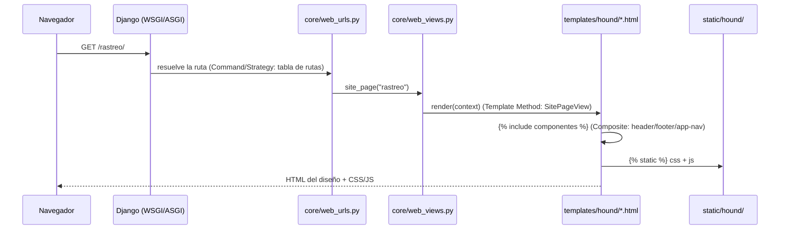

# M54 · Sitio público servido por Django

Objetivo: entregar la interfaz visual de M54 —las 42 pantallas del diseño `diseñohounde.zip`— servida por Django, sin tocar la lógica del backend ni la base de datos y con las 109 pruebas en verde.
Rama: `backend` → PR a `pruebas` → PR a `main`.
Estrategia de entrega: trabajo directo inline (un solo comportamiento: composición del sitio público).
Runner: `backend/.venv/bin/python manage.py test` (109 pruebas) + verificación HTTP de las 47 rutas.

## Specs

S1 — "crea al fornten necesario para la entrega"
Alcance: publicar las 42 pantallas del diseño entregado como sitio público de Hound Express (portada, rastreo, servicios, cobertura, alianzas, portal de Socio, panel de operaciones, blog, contacto, legales, errores).
Criterio: cada ruta del mapa de pantallas responde 200 y renderiza el diseño convertido; las 42 plantillas existen bajo `backend/templates/hound/`.
Comprobaciones: verificación HTTP de las 47 rutas; `manage.py check`.

S2 — "no ... rompas nada manten la estabilidad del backend y del db"
Alcance: no modificar `models.py`, servicios, migraciones ni la base de datos; no cambiar el contrato de la API.
Criterio: `manage.py test` sigue en `Ran 109 tests ... OK`; `manage.py check --deploy` sin avisos; gitleaks sin hallazgos.
Comprobaciones: suite completa (109), `check --deploy` con `DJANGO_DEBUG=false`, `gitleaks git` y `gitleaks dir backend`.

S3 — "utiliza el framework de metapromting ... una entrega ... utilizando el odd"
Alcance: este documento fija las specs, las tareas y el log; la conversión del diseño es reproducible con un generador versionado.
Criterio: `backend/tools/build_ui_from_design.py` regenera las plantillas y estilos desde el export del diseño; este documento registra decisiones y evidencia.
Comprobaciones: reejecución del generador sin diff en las plantillas.

S4 — "utiliza recursos ... de manera generica ... para garantizar la estabilidad y una entrega completa"
Alcance: aplicar el brief de recursos obligatorio del kit de Hound Express y dejar recibo de cada recurso.
Criterio: brief y recibo de recursos en la entrega; los recursos MANDATORY del kit aparecen como usados con evidencia o como pendientes con la decisión explícita de Eduardo.
Comprobaciones: recibo con evidencia por recurso.

S5 — "una entrega completa funcional de la m54 con una funcionalidad avanzada"
Alcance: sitio público navegable de punta a punta (menú, navegación interna, páginas de detalle, páginas 404/500 y mantenimiento), estilos y marca del diseño, y comportamiento de menú móvil.
Criterio: navegación interna sin enlaces rotos (todos los `` resuelven), estilos del diseño aplicados, `hound.js` alterna el menú móvil.
Comprobaciones: verificación HTTP de las 47 rutas; inspección de los `` generados; revisión del HTML renderizado.

S6 — "no quiero un backned devil tampoco quiero un frontend"
Alcance: la entrega incluye backend vivo y frontend vivo en el mismo producto.
Criterio: la API sigue respondiendo en `/api/v1/health/` y el sitio público responde en `/`; ninguno de los dos queda como cascarón vacío.
Comprobaciones: `/api/v1/health/` → 200 con `{"status":"ok","database":"ok"}`; `/` → 200 con el contenido del diseño.

## Tasks

- T1 · S1 · inline · Convertir el export del diseño a plantillas, estilos y marca. Hecho: 42 páginas + 3 componentes + 404/500.
- T2 · S1, S5 · inline · Mapear las 42 rutas Django y componer encabezado, pie y navegación de panel/portal. Hecho: `core/web_urls.py`, `core/web_views.py`.
- T3 · S2 · inline · Verificar que backend, API y base de datos quedan intactos. Hecho: 109 pruebas OK, `check --deploy` sin avisos, gitleaks limpio.
- T4 · S5 · inline · Pila local con Docker y su job de CI. Hecho: `backend/Dockerfile`, `docker-compose.yml`, job `docker-compose` y bloque en el README.
- T5 · S3, S4 · inline · Documentar la entrega (este documento, diagrama, brief y recibo de recursos).

## Diagrama

Flujo de una página del sitio público, con los patrones que el código usa de verdad:

Patrones y evidencia: tabla de rutas (`backend/core/web_urls.py`), vista base con contexto mínimo (`backend/core/web_views.py`), composición por `` (`backend/templates/hound/componentes/`), recursos estáticos servidos por `STATICFILES_DIRS` (`backend/config/settings.py`).

## Log

- L1 · Petición del usuario (verbatim): "utiliza recursos no quise una backned devil tampoco quiero un frontend haz de manera gentica utiliza los recurso para garantizar la estabilidad y una entrega completa de la m54 con una funcionalidad avanzada gracias al odd"; "crea al fornten necesario para la entrega ya sabes utiliza el framework de metapromting para mejorar le pormt para que este cumpla con una entrega utilizando el odd"; "ojo asegurate de utilizar los recursos no e equivoques no rompas nada manten la estabilidad del backend y del db".
- L2 · Decisión: el sitio público se sirve con plantillas y estáticos de Django, generados desde el export del diseño con un generador versionado (`backend/tools/build_ui_from_design.py`). Motivo: es la vía verificable de punta a punta sin `npm` y sin tocar la lógica del backend; la app React sigue en su rama.
- L3 · Decisión: los estados del canvas se resuelven con `hint-placeholder-val` (fuente de verdad del propio export); los estados no visibles quedan en el HTML ocultos con `hidden`, listos para que Django los active.
- L4 · Decisión: los scripts inline del export son clases React del runtime del canvas (`DCLogic`) y no corren sin ese runtime, así que no se portan; el menú móvil se resuelve con `static/hound/js/hound.js`.
- L5 · Cambio de comportamiento del backend: la raíz ya no redirige a `/api/v1/health/`, ahora sirve la portada. Se actualizó la prueba existente `test_root_redirects_to_health` → `test_root_serves_public_homepage` (sigue siendo 109 pruebas) y el texto del README.
- L6 · Evidencia: 47 rutas verificadas en 200; `Ran 109 tests ... OK`; `manage.py check` sin avisos; `check --deploy` con `DJANGO_DEBUG=false` sin avisos; `gitleaks git` y `gitleaks dir backend` sin hallazgos.
- L7 · Commit: `a9e94bf` en la rama `backend` (hook de revisión pre-commit en verde; 109 pruebas, ruff y 46 rutas verificadas antes del commit).
- L8 · Pendiente de decisión de Eduardo: (a) React frente a plantillas Django para el frontend de `main`; (b) HTML interactivo del diagrama con Archify (la fuente Mermaid está en este documento); (c) arrancar Docker Desktop para el build local de la imagen.
- L9 · 2026-11-01. Revisión posterior a L7: el generador borraba `href=` en los enlaces (`<a `), así que ningún enlace interno funcionaba. La comprobación de L6 solo pedía cada ruta y no seguía los enlaces. Se corrigió con TDD y se agregó `core/tests/test_web_navigation.py`.
- L10 · 2026-11-02. La misma revisión encontró más pérdidas del generador: 21 `` sin `src`, enlaces sin `href` en 404 y 500, encabezado oculto bajo el hero por perder `sticky` y `z-index`, columnas sin resolver que dejaban el menú del panel a página completa, enlace activo duplicado, sin versión móvil y detalles que siempre mostraban la variante por defecto.
- L11 · Decisión que reemplaza a L3: `hint-placeholder-val` no es la fuente de verdad, porque el export marca `e_datos` como falso y por eso las pantallas con datos salían vacías. El estado inicial sale de `estado` en el script de cada página. Los estados de ancho los cambia el CSS de `base.html`, las columnas son variables CSS con media queries y las variantes de detalle las elige la ruta. Reemplaza en parte a L4: se porta esa lógica, no el runtime.
- L12 · Evidencia: `Ran 126 tests ... OK`; ruff limpio; `check --deploy` sin avisos; gitleaks sin fugas; regenerar desde el export coincide con las plantillas (solo difieren `base.html` y `js/`, que se escriben a mano); las 42 pantallas auditadas en el navegador a 375, 768 y 1280 px sin desborde, sin imágenes rotas y sin enlaces sin `href`; clic real en el encabezado, en el menú móvil y en un enlace del menú.
- L13 · Límite que sigue abierto: los efectos `style-hover` del export no se portan (el sitio funciona sin ellos) y las pantallas no se conectan a la API hasta M64 y M66.
- L14 · 2026-11-02: esta ruta quedó reemplazada por `odd/tasks/web-completa.md`. Eduardo: "el .zip era para que se tomara de referencia". El código queda en la rama local `respaldo/sitio-django-opencode`, sin publicar.
